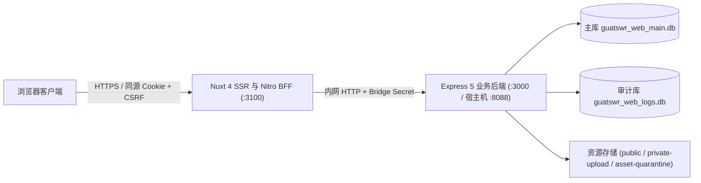
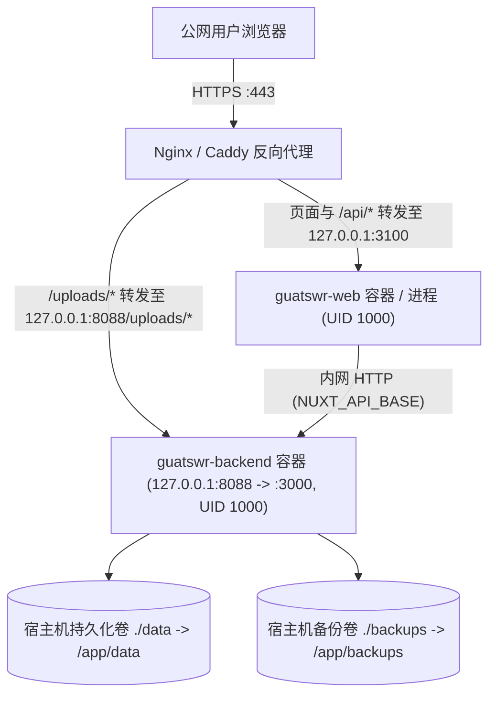

<a id="readme-top"></a>

<p align="center">
  
</p>

<h1 align="center">桂航绯想天 · GuatSWR Website</h1>

<p align="center">桂林航天工业学院东方同好社群网站</p>

<p align="center">
  <a href="https://github.com/guatswr/GuatSWR_Website/releases/tag/v2.0.0"></a>
  <a href="https://github.com/guatswr/GuatSWR_Website/actions/workflows/backend.yml?query=branch%3Amain"></a>
  <a href=".node-version"></a>
  <a href="web/package.json"></a>
  <a href="backend/package.json"></a>
  <a href="backend/package.json"></a>
</p>

<p align="center">
  <a href="#快速开始">快速开始</a> ·
  <a href="#本地调试指南">本地调试</a> ·
  <a href="#服务器部署教程">服务器部署</a> ·
  <a href="#后续运维教程">后续运维</a> ·
  <a href="docs/releases/v2.0.0.md">v2.0.0 版本说明</a> ·
  <a href="https://github.com/guatswr/GuatSWR_Website/issues">问题反馈</a>
</p>

本仓库包含桂航绯想天社群网站的公开前端、同源 BFF 服务层与 Express 业务后端。社团成员可浏览活动文章、投稿活动、报名STG与非想天则比赛、查阅成员列表与群史；管理员可通过后台审核投稿、录入赛果、管理成员与权限，并执行整站数据备份。

<details>
<summary>阅读目录</summary>

- [功能与页面](#功能与页面)
- [架构与工作区结构](#架构与工作区结构)
- [快速开始](#快速开始)
  - [1. 环境要求与依赖安装](#1-环境要求与依赖安装)
  - [2. 配置前后端环境变量](#2-配置前后端环境变量)
  - [3. 初始化双数据库与超级管理员](#3-初始化双数据库与超级管理员)
  - [4. 启动本地服务](#4-启动本地服务)
- [本地调试指南](#本地调试指南)
  - [1. 终端链路连通性自检](#1-终端链路连通性自检)
  - [2. 核心业务流程联调步骤](#2-核心业务流程联调步骤)
  - [3. 浏览器 Network 与后端日志关联排查](#3-浏览器-network-与后端日志关联排查)
  - [4. 修改文件后的热重载与重启规则](#4-修改文件后的热重载与重启规则)
  - [5. VS Code 后端 TypeScript 断点调试](#5-vs-code-后端-typescript-断点调试)
  - [6. 本地调试常见报错速查](#6-本地调试常见报错速查)
- [开发与质量门禁](#开发与质量门禁)
- [服务器部署教程](#服务器部署教程)
  - [1. 生产部署拓扑与运行约束](#1-生产部署拓扑与运行约束)
  - [2. 准备宿主机目录与非 root 权限](#2-准备宿主机目录与非-root-权限)
  - [3. 数据库准备（全新初始化 vs 历史库接管升级）](#3-数据库准备全新初始化-vs-历史库接管升级)
  - [4. 配置生产环境变量](#4-配置生产环境变量)
  - [5. 构建与启动服务（Docker 容器与原生 Node）](#5-构建与启动服务docker-容器与原生-node)
  - [6. 反向代理（Nginx）配置与上线核验](#6-反向代理nginx配置与上线核验)
- [后续运维教程](#后续运维教程)
  - [1. 日常版本升级与平滑重启流程](#1-日常版本升级与平滑重启流程)
  - [2. 数据备份、完整性验包与灾难恢复](#2-数据备份完整性验包与灾难恢复)
  - [3. 文件隔离区与存储清理维护](#3-文件隔离区与存储清理维护)
  - [4. 账号安全、令牌撤销与审计日志维护](#4-账号安全令牌撤销与审计日志维护)
  - [5. 应急只读回退模式](#5-应急只读回退模式)
  - [6. 运维故障与残留锁文件处理](#6-运维故障与残留锁文件处理)
- [文档导航](#文档导航)

</details>

## 功能与页面

| 路由入口 | 页面职责 |
| --- | --- |
| `/` | 首页：社团简介、常驻企划方向、近期活动预告与往期回顾 |
| `/activities` · `/activity/:id` | 活动文章列表与正文（支持 Markdown、代码高亮、KaTeX 公式与 Mermaid 图表） |
| `/events` · `/events/:type` | 活动中心：悬赏令、非想天则、东方 STG、聚会、竞猜；支持游客草稿投稿、活动报名与赛果展示 |
| `/members` · `/history` | 住民名册（成员档案、院校分布）与群史时间轴 |
| `/social` · `/join` | 关联社群导航与入群迎新指引 |
| `/logs` | 经服务端投影与脱敏处理的公开站点操作日志 |
| `/login` · `/admin` | 管理员登录（支持二步验证密码）与后台：文章、活动审核、成员、群史、站点配置、账号权限与备份管理 |

公开页面由 Nuxt SSR 实时渲染（每次请求生成独立 CSP nonce，服务端数据层采用 SWR 缓存），支持深浅色主题切换、移动端适配与 `prefers-reduced-motion` 减弱动态效果。所有管理员操作与游客写操作均通过同源 Nitro BFF（`/api/bff/**`）完成鉴权、CSRF 校验、Origin 校验与请求体限流，后端签发的 JWT 密文仅保存在 BFF 服务端。

## 架构与工作区结构



```text
GuatSWR_Website/
├── web/                        # @guatswr/web：Nuxt 4 + Vue 3 + TypeScript 前端与 Nitro BFF
│   ├── app/                    # 页面路由、组件、Pinia 状态与客户端逻辑
│   ├── server/                 # BFF 鉴权、游客草稿网关、上传流式转发与公开数据 SWR 适配
│   └── tests/                  # 前端单测、BFF 集成测试与 Playwright E2E
├── backend/                    # guiair-backend：Express 5 + 严格 TypeScript 业务后端
│   ├── src/                    # 业务模块、双库迁移引擎、文件事务发布、隔离清理与备份调度
│   ├── scripts/                # 备份/恢复/验包工具（Bash + Python 3）、只读回退启动器与容器冒烟脚本
│   └── docs/openapi.yaml       # 后端 71 个操作的 OpenAPI 契约定义
├── packages/shared/            # @guatswr/shared：前后端共用的 Zod 4 校验契约（ESM / CJS 双产物）
├── scripts/                    # 仓库级备份入口包装、依赖安全审计、导入边界与路由体积预算检查
├── patches/                    # 经 SHA-256 锁定的上游依赖安全补丁
└── docs/                       # 架构说明、后端现代化运行手册（BM 系列）与前端改版验收记录
```

三个包共用根目录 `pnpm-lock.yaml`。后端业务层使用严格 TypeScript 编译至 `backend/dist/`，保留少量 CommonJS 平台装配层；主数据库（当前版本 `3`）与审计日志库（当前版本 `2`）各自维护独立的迁移账本。旧版 v1 前端源码保存在 Git 标签 `v1-archive` 中。

<p align="right">(<a href="#readme-top">返回顶部</a>)</p>

## 快速开始

以下步骤适用于**全新的本地空白开发环境**。若手头已有历史数据库文件，请先阅读[数据库迁移运行手册](docs/backend-modernization/MIGRATIONS.md)，切勿对非空历史库执行 `initialize`。

### 1. 环境要求与依赖安装

- **Node.js**：`24.16.0`（见 [`.node-version`](.node-version)，工作区限制 `>=24.16.0 <25`）
- **包管理器**：`pnpm@11.25.0`
- **原生编译与脚本工具**：`sqlite3` 与 `sharp` 含原生扩展，若预编译二进制未命中而回退源码编译，需安装 Python 3 与对应平台的 C/C++ 编译工具链（Windows Visual Studio C++ Build Tools / Linux `build-essential`）。执行完整备份与恢复脚本另需 `bash`、`python3`、`sqlite3` 命令行、`tar` 与 `sha256sum`。

克隆仓库并构建共享契约与后端产物：

```sh
git clone https://github.com/guatswr/GuatSWR_Website.git
cd GuatSWR_Website
npm install --global pnpm@11.25.0
pnpm install --frozen-lockfile
pnpm --filter @guatswr/shared build
pnpm --filter guiair-backend build
```

### 2. 配置前后端环境变量

首次运行时，将示例文件复制为本地 `.env`（`.env` 已被 Git 忽略，不会入库）：

```sh
cp backend/.env.example backend/.env
cp web/.env.example web/.env
```

本地调试建议将数据库、上传文件与备份全部放在 `backend/.data/` 隔离目录下，避免污染默认路径。先在仓库根目录打印两个隔离目录的绝对路径：

```sh
node -e "const p=require('node:path'); console.log('DATA_DIR='+p.resolve('backend/.data/dev')); console.log('BACKUP_ROOT='+p.resolve('backend/.data/dev-backups'))"
```

再连续执行以下命令 **3 次**，生成 3 组独立的 64 位十六进制随机密钥（分别用于 `JWT_SECRET`、`BFF_BRIDGE_SECRET` 与 `NUXT_SESSION_PASSWORD`）：

```sh
node -e "console.log(require('node:crypto').randomBytes(32).toString('hex'))"
```

编辑 `backend/.env`，填入刚才生成的绝对路径、密钥与初始超级管理员账号：

```dotenv
NODE_ENV=development
BIND_HOST=127.0.0.1
PORT=3000

# 填入上面打印的绝对路径（PUBLIC_DIR 默认解析为 DATA_DIR/public）
DATA_DIR=
BACKUP_ROOT=

# 填入第 1 组随机密钥
JWT_SECRET=
# 填入第 2 组随机密钥（必须与 web/.env 的 NUXT_BFF_BRIDGE_SECRET 完全一致）
BFF_BRIDGE_SECRET=

# 本地回环代理与站点地址
TRUST_PROXY_CIDRS=127.0.0.1/32,::1/128
SITE_URL=http://127.0.0.1:3100
CORS_ORIGINS=http://127.0.0.1:3100

# 仅供下一步 admin:bootstrap 显式创建首位超级管理员使用
SUPER_ADMIN_USERNAME=site-admin
SUPER_ADMIN_PASSWORD=ChangeMe_123456
```

编辑 `web/.env`，填入对应的后端地址与会话密钥：

```dotenv
NUXT_API_BASE=http://127.0.0.1:3000

# 填入第 3 组随机密钥（至少 32 个字符，不可与 JWT_SECRET 混用）
NUXT_SESSION_PASSWORD=
# 填入第 2 组随机密钥（与 backend/.env 的 BFF_BRIDGE_SECRET 完全一致）
NUXT_BFF_BRIDGE_SECRET=

# 允许本地回环地址发起写操作并在 HTTP 下写入会话 Cookie
NUXT_BFF_AUTH_ALLOWED_ORIGINS=["http://127.0.0.1:3100"]
NUXT_BFF_AUTH_TRUSTED_PROXY_CIDRS=[]
NUXT_BFF_AUTH_ALLOW_INSECURE_LOOPBACK_COOKIES=true

HOST=127.0.0.1
PORT=3100
```

<details>
<summary>核心环境变量说明表（点击展开）</summary>

| 变量名 | 所属端 | 校验规则与作用 |
| --- | --- | --- |
| `DATA_DIR` | Backend | 必填绝对路径。存放 `guatswr_web_main.db`、`guatswr_web_logs.db` 及私有上传/隔离目录 |
| `PUBLIC_DIR` | Backend | 公开静态资源绝对路径，默认 `$DATA_DIR/public`。严禁与 `DATA_DIR` 根、`BACKUP_ROOT` 或私有子目录重叠 |
| `BACKUP_ROOT` | Backend | 备份归档绝对路径，默认 `backend/backups`。不得位于 `PUBLIC_DIR` 内 |
| `JWT_SECRET` | Backend | 非空字符串，用于后端签发与校验业务 JWT |
| `BFF_BRIDGE_SECRET` | Backend | `32～256` 位可见 ASCII 字符。生产环境必填，用于校验来自 Nitro BFF 的游客草稿证明 |
| `GUEST_DRAFT_PROOF_MODE` | Backend | 默认 `required`（强制校验 BFF 桥接证明）；仅兼容过渡期可设为 `optional` |
| `TRUST_PROXY_CIDRS` | Backend | 逗号分隔的可信反向代理/BFF CIDR 列表；为空时不信任任何 `X-Forwarded-For` |
| `BACKUP_SCHEDULER_OWNER` | Backend | `app`（默认，由后端进程内置定时器按后台设置触发备份）或 `external`（由宿主机 cron 触发） |
| `SUPER_ADMIN_USERNAME` | Backend | `1～50` 位 ASCII 字母、数字、`_` 或 `-`；仅被 `admin:bootstrap` CLI 读取 |
| `SUPER_ADMIN_PASSWORD` | Backend | `6～100` 字符且 UTF-8 字节长度 `<= 72`（防止 bcrypt 静默截断）；仅被 `admin:bootstrap` CLI 读取 |
| `NUXT_API_BASE` | Web (BFF) | Nitro 服务端访问 Express 的内部 Origin（不带 `/api` 后缀，如 `http://127.0.0.1:3000`） |
| `NUXT_SESSION_PASSWORD` | Web (BFF) | 至少 32 位字符。通过 HKDF-SHA256 派生服务端 JWT 封存密钥（AES-256-GCM）与 CSRF 签名密钥 |
| `NUXT_BFF_BRIDGE_SECRET` | Web (BFF) | 必须与后端的 `BFF_BRIDGE_SECRET` 完全一致 |
| `NUXT_BFF_AUTH_ALLOWED_ORIGINS` | Web (BFF) | JSON 字符串数组（如 `["http://127.0.0.1:3100"]`）。写请求 `Origin` 必须精确匹配，否则返回 403 |
| `NUXT_BFF_AUTH_TRUSTED_PROXY_CIDRS` | Web (BFF) | JSON 字符串数组。仅当直接连接对端位于此 CIDR 内时才解析 `X-Forwarded-For` |
| `NUXT_BFF_AUTH_ALLOW_INSECURE_LOOPBACK_COOKIES` | Web (BFF) | 布尔值，默认 `false`。仅在非生产环境且连接与 `Host` 均为回环地址时允许明文 HTTP Cookie |

</details>

### 3. 初始化双数据库与超级管理员

后端服务在正常启动时**只做只读迁移账本与结构指纹校验**，不会自动建表、改表或创建管理员。首次启动前必须显式执行初始化命令。

先创建配置中的 `DATA_DIR` 目录：

```sh
node --env-file=backend/.env -e "require('node:fs').mkdirSync(process.env.DATA_DIR,{recursive:true})"
```

然后在仓库根目录按当前操作系统执行双库初始化（目标版本为 `main: 3`、`audit: 2`）与首位超级管理员创建：

<details open>
<summary>Windows PowerShell</summary>

```powershell
$devData = node --env-file=backend/.env -p "process.env.DATA_DIR"
pnpm --filter guiair-backend db:migrate initialize --data-dir $devData
pnpm --filter guiair-backend db:check --data-dir $devData
node --env-file=backend/.env backend/dist/src/admin/bootstrap-cli.js --main-db (Join-Path $devData 'guatswr_web_main.db')
```

</details>

<details>
<summary>Linux / macOS (Bash / Zsh)</summary>

```sh
DEV_DATA_DIR="$(node --env-file=backend/.env -p 'process.env.DATA_DIR')"
pnpm --filter guiair-backend db:migrate initialize --data-dir "$DEV_DATA_DIR"
pnpm --filter guiair-backend db:check --data-dir "$DEV_DATA_DIR"
node --env-file=backend/.env backend/dist/src/admin/bootstrap-cli.js --main-db "$DEV_DATA_DIR/guatswr_web_main.db"
```

</details>

执行成功后：
- `db:check` 会输出两行 JSON，`main` 的 `version` 为 `3`，`audit` 的 `version` 为 `2`。
- `bootstrap-cli.js` 首次创建会输出 `{"bootstrap":{"status":"created","username":"site-admin"}}`；对已存在的同名超级管理员重复执行会返回 `unchanged`，不会重置密码，也不会提升普通用户权限。

### 4. 启动本地服务

打开两个独立终端，均在仓库根目录运行：

**终端 1 — 启动 Express 业务后端（监听 `127.0.0.1:3000`）：**

```sh
pnpm --filter guiair-backend dev
```

**终端 2 — 构建共享包并启动 Nuxt 前台与 BFF（监听 `127.0.0.1:3100`）：**

```sh
pnpm dev
```

| 本地访问地址 | 说明 |
| --- | --- |
| [http://127.0.0.1:3100](http://127.0.0.1:3100) | 网站前台首页（**请统一使用 `127.0.0.1:3100` 而非 `localhost:3100`**，以匹配 `NUXT_BFF_AUTH_ALLOWED_ORIGINS`） |
| [http://127.0.0.1:3100/login](http://127.0.0.1:3100/login) | 管理员登录页（输入刚才初始化的 `SUPER_ADMIN_USERNAME` 与密码） |
| [http://127.0.0.1:3100/api/health](http://127.0.0.1:3100/api/health) | Nuxt / Nitro 进程存活探针 |
| [http://127.0.0.1:3000/api/version](http://127.0.0.1:3000/api/version) | 后端存活与契约版本接口（固定返回 `{"version":"4.0","status":"online"}`） |
| [http://127.0.0.1:3000/api/docs](http://127.0.0.1:3000/api/docs) | 后端 Swagger UI 接口文档 |

<p align="right">(<a href="#readme-top">返回顶部</a>)</p>

## 本地调试指南

在完成「快速开始」并保持前后端两个终端运行后，可按以下步骤在本地验证完整读写链路、设置断点与排查问题。

### 1. 终端链路连通性自检

打开第三个终端，依次探测后端存活、Nuxt 存活、SSR 公开读取适配以及 BFF 鉴权握手（Windows PowerShell 请使用 `curl.exe`，Linux/macOS 使用 `curl`）：

```powershell
# 1. 检查 Express 后端是否就绪（预期返回 {"version":"4.0","status":"online"}）
curl.exe -fsS http://127.0.0.1:3000/api/version

# 2. 检查 Nuxt 服务是否就绪（预期返回 200 OK）
curl.exe -fsS http://127.0.0.1:3100/api/health

# 3. 检查 Nuxt 服务端是否成功从后端拉取站点公开配置
curl.exe -fsS http://127.0.0.1:3100/api/config

# 4. 检查 BFF 会话状态与 CSRF 签发接口
curl.exe -fsS http://127.0.0.1:3100/api/bff/auth/session
curl.exe -fsS -i http://127.0.0.1:3100/api/bff/auth/csrf
```

若前两步成功而第 3 步报错，说明 `web/.env` 中的 `NUXT_API_BASE` 未指向正在运行的后端端口。

### 2. 核心业务流程联调步骤

空白开发库不含历史数据，建议按以下顺序验证四条核心业务链路：

1. **管理员登录与后台写操作（验证 BFF 会话与缓存失效）**
   - 浏览器访问 `http://127.0.0.1:3100/login`，使用初始化的超级管理员登录。
   - 进入 `/admin` 后台，在「活动文章」中新建并发布一篇测试文章（可插入 Markdown 标题、代码块与图片）。
   - 打开前台 `/activities` 与文章详情页，确认新文章已立即可见（验证 BFF 写操作成功后自动触发 `invalidatePublicData` 刷新服务端 SWR 缓存）。
2. **游客活动草稿投稿与流式上传（验证 Bridge 密钥与草稿归属）**
   - 打开一个**浏览器无痕窗口**访问 `http://127.0.0.1:3100/events`，点击发起活动投稿。
   - 此时前端会调用 `POST /api/bff/guest/events/draft` 创建草稿并写入 `HttpOnly` 草稿归属 Cookie（路径限制为 `/api/bff/guest`）。
   - 在表单中上传内容图片（走 `POST /api/bff/guest/upload/content`，BFF 校验文件前 256 字节魔数与 50 MiB 上限后流式转发至后端私有暂存区）并提交审核。
   - 切回普通窗口的 `/admin` 后台「活动管理」，审核通过该草稿，观察图片从私有暂存区原子发布到 `PUBLIC_DIR` 并在前台 `/events` 展示。
3. **活动报名与取消（验证报名截止规则与头像上传）**
   - 在后台创建一个状态为 `published` 或 `ongoing` 的 `东方STG` 或 `非想天则` 测试活动。
   - 在前台打开该活动详情，上传参赛头像（`POST /api/bff/guest/upload/avatar`）、填写报名表并提交（`POST /api/bff/guest/events/:id/signup`）。
   - 刷新页面确认当前访客报名信息正常回显，再点击取消报名（`DELETE /api/bff/guest/events/:id/signup`）验证状态清除。
4. **回收站彻底删除与文件隔离（验证 `asset_cleanup_jobs`）**
   - 在后台将测试文章或测试活动移入回收站并执行「永久删除」。
   - 检查 `backend/.data/dev/asset-quarantine/` 目录：被删除且无其他内容引用的上传图片不会立即从磁盘抹除，而是会在后台清理周期（每 30 秒一批）被原子 `rename` 到隔离区目录，供误删恢复使用。

### 3. 浏览器 Network 与后端日志关联排查

当页面提示请求失败时，不要直接猜测原因，按以下两步定位：

1. **查看浏览器 DevTools Network 面板**：筛选 `/api/bff/` 请求，查看响应状态码、返回体 `{"error":{"code":"...","message":"..."}}` 以及响应头中的 `X-Request-ID`。出于安全边界设计，BFF 会拦截并隐去所有上游原始报错堆栈、SQL 错误和敏感字段，仅向浏览器返回固定错误码。
2. **对照后端终端 Pino 结构化日志**：在运行 `guiair-backend` 的终端中查找同一个 `requestId`。后端日志会记录完整的事件类型：
   - `http.completed`：包含 `method`、`route`、`status` 与 `durationMs`
   - `http.failed`：包含未捕获路由异常或上游失败原因
   - `task.started` / `task.completed` / `task.failed`：后台异步任务（清理、审计投递、自动备份）执行情况
   - `audit.failed` / `backup.failed` / `storage.cleanup.retry`：子系统告警

> [!IMPORTANT]
> 反馈问题或贴出调试日志时，只保留 `X-Request-ID`、状态码与脱敏后的日志片段，切勿粘贴浏览器 `Cookie`、后端 `Authorization` 头、`JWT_SECRET`、`NUXT_SESSION_PASSWORD` 或 `BFF_BRIDGE_SECRET`。

### 4. 修改文件后的热重载与重启规则

不同目录的代码改动对运行中进程的影响不同：

| 修改的文件范围 | 生效方式与注意事项 |
| --- | --- |
| `web/app/**`（页面、组件、样式） | Vite / Nuxt HMR 自动热更新，无需重启，登录态保留 |
| `web/server/**`（Nitro BFF 路由、工具） | Nitro 会自动重载服务端模块，但**进程内存中的 BFF 登录会话与游客草稿归属表会被清空**；重载后需在浏览器重新登录或新建测试草稿 |
| `backend/src/**` 或 `backend/server.js` | `nodemon` 监听到 `.ts`/`.js`/`.json` 变化后，自动发送 `SIGTERM` 优雅停机、重新执行 `npm run build` 并重启后端 |
| `packages/shared/src/**`（共享 Zod 契约） | **不会自动跨包热编译**。修改后必须先运行 `pnpm --filter @guatswr/shared build`，再重启前后端开发终端，防止两端继续使用旧缓存产物 |
| `backend/.env` 或 `web/.env` | 环境变量仅在进程启动时读取，修改后需在对应终端按 `Ctrl+C` 停止并重新启动 |

### 5. VS Code 后端 TypeScript 断点调试

后端生产与常规开发构建默认不生成 Source Map。如需在 VS Code 中对 `backend/src/**/*.ts` 源码打断点单步调试：

**步骤 1：停止常规后端开发终端（避免 `3000` 端口冲突），在仓库根目录编译带内联 Source Map 的调试产物并启动 Inspector：**

```sh
pnpm --filter @guatswr/shared build
pnpm --filter guiair-backend build
pnpm --filter guiair-backend exec tsc -p tsconfig.build.json --sourceMap --inlineSources
node --env-file=backend/.env --inspect=127.0.0.1:9230 --enable-source-maps backend/dist/server.js
```

**步骤 2：在仓库根目录 `.vscode/launch.json` 中添加 Attach 配置：**

```json
{
  "version": "0.2.0",
  "configurations": [
    {
      "name": "Attach GuatSWR Backend (9230)",
      "type": "node",
      "request": "attach",
      "address": "127.0.0.1",
      "port": 9230,
      "sourceMaps": true,
      "outFiles": ["${workspaceFolder}/backend/dist/**/*.js"],
      "skipFiles": ["<node_internals>/**"]
    }
  ]
}
```

**步骤 3：在 VS Code「运行和调试」面板选择 `Attach GuatSWR Backend (9230)` 启动连接**，即可在 `backend/src/` 下的任意 `.ts` 文件中命中断点。

**步骤 4：调试结束后的清理**。调试端口仅可绑定 `127.0.0.1`。调试完毕后，按 `Ctrl+C` 停止进程，并重新运行一次标准构建以清除 `dist/` 中的调试 Source Map：

```sh
pnpm --filter guiair-backend build
```

### 6. 本地调试常见报错速查

<details>
<summary>点击展开本地常见问题与解决方法</summary>

1. **登录或提交表单时返回 `403 Forbidden`（错误码 `forbidden` 或 Origin 校验失败）**
   - **原因**：浏览器地址栏使用了 `http://localhost:3100`，而 `web/.env` 中配置的是 `NUXT_BFF_AUTH_ALLOWED_ORIGINS=["http://127.0.0.1:3100"]`。BFF 对 `Origin` 执行严格字符串全等匹配。
   - **解决**：统一使用 `http://127.0.0.1:3100` 访问，或将两个地址同时加入 `NUXT_BFF_AUTH_ALLOWED_ORIGINS` 的 JSON 数组中并重启 `pnpm dev`。
2. **登录接口返回 200，但跳转到 `/admin` 立即掉线回到 `/login`**
   - **原因**：会话 Cookie 默认带有 `Secure` 属性；在本地明文 HTTP 下若未开启回环豁免，浏览器会拒绝保存 Cookie。
   - **解决**：确认 `web/.env` 中已设置 `NUXT_BFF_AUTH_ALLOW_INSECURE_LOOPBACK_COOKIES=true`，且使用 `127.0.0.1` 回环地址访问。
3. **游客创建草稿或提交活动时返回 `403` / `502`**
   - **原因**：`backend/.env` 的 `BFF_BRIDGE_SECRET` 与 `web/.env` 的 `NUXT_BFF_BRIDGE_SECRET` 不一致，或密钥长度不足 32 位可见 ASCII 字符。
   - **解决**：核对两端密钥是否完全相同，修改后同时重启后端与 Nuxt。
4. **后端启动立即退出并报 `MIGRATION_REQUIRED` 或 `MIGRATION_SCHEMA_DRIFT`**
   - **原因**：`DATA_DIR` 指向了尚未初始化的空目录，或本地代码更新了数据库迁移版本但开发库尚未升级。
   - **解决**：空目录执行 `db:migrate initialize`；已有开发库执行 `pnpm --filter guiair-backend db:migrate upgrade --data-dir <绝对路径>`。
5. **后端启动报 `Invalid configuration: STORAGE_LAYOUT`**
   - **原因**：`PUBLIC_DIR`、`DATA_DIR` 与 `BACKUP_ROOT` 之间存在目录包含关系（例如把 `BACKUP_ROOT` 放在了 `PUBLIC_DIR` 内，或把 `PUBLIC_DIR` 设为了 `DATA_DIR` 本身），或者主库与日志库指向了同一个文件。
   - **解决**：确保 `DATA_DIR` 与 `BACKUP_ROOT` 是相互独立的绝对路径，`PUBLIC_DIR` 保持默认（即 `$DATA_DIR/public`）或指向完全独立的静态目录。

</details>

<p align="right">(<a href="#readme-top">返回顶部</a>)</p>

## 开发与质量门禁

所有工作区检查命令均在**仓库根目录**运行：

| 命令 | 检查范围与说明 |
| --- | --- |
| `pnpm typecheck` | 先构建 `@guatswr/shared`，再对全工作区执行严格 TypeScript 类型检查 |
| `pnpm lint` | 运行全工作区 ESLint 检查（后端限制 `--max-warnings=0`） |
| `pnpm test` | 运行 `shared`、`web` 与 `backend` 的单元测试、契约测试与集成测试 |
| `pnpm --filter guiair-backend test:unit` | 单独运行后端引导测试与单元测试 |
| `pnpm --filter guiair-backend test:contracts` | 单独运行后端 OpenAPI 与共享契约一致性测试 |
| `pnpm --filter guiair-backend test:integration` | 单独运行后端 SQLite / 上传 / 鉴权集成测试 |
| `pnpm --filter guiair-backend test:bff` | 真实 Nuxt BFF 产物 + 真实 Express 后端端到端联测（**运行前须先执行 `pnpm --filter @guatswr/web build`**） |
| `pnpm test:tooling` | 运行仓库边界检查器、路由体积检查器、安全补丁探针与隔离 E2E 执行器自测 |
| `pnpm check:boundaries` | 校验浏览器端、Nitro 服务端与共享包之间的模块导入边界 |
| `pnpm check:security` | 校验 `patches/` 补丁 SHA-256 与漏洞修复探针，并执行 pnpm 在线安全审计 |
| `pnpm build` | 构建 `shared`、`web` 与 `backend` 全部生产产物 |
| `pnpm check:artifacts` | 校验构建产物完整性（无残留 Source Map、私有配置未混入客户端 bundle 等，需先 `pnpm build`） |
| `pnpm check:routes` | 启动无头浏览器测量各公开路由初始 JS 体积预算（需先 `pnpm build` 并安装 Chromium） |

**运行 Playwright 隔离 E2E 测试：**

E2E 测试会在 `3100`、`3181`、`3182` 端口启动隔离测试服务与合成数据夹具，不会触碰本地开发数据库。运行前请确保上述三个端口未被占用：

```sh
pnpm build
pnpm --filter @guatswr/web exec playwright install chromium
pnpm test:e2e
```

> [!NOTE]
> 在 Linux 主机上运行 Playwright E2E 或 Lighthouse 性能采集（`pnpm --filter @guatswr/web test:performance`）前，需先安装中文字体与浏览器系统依赖：`sudo apt-get update && sudo apt-get install -y fonts-noto-cjk && pnpm --filter @guatswr/web exec playwright install --with-deps chromium`。

<p align="right">(<a href="#readme-top">返回顶部</a>)</p>

## 服务器部署教程

本节提供将前后端部署至 Linux 生产服务器的完整步骤。正式生产发布前，请同时对照 [BM-36 发布检查清单](docs/backend-modernization/RELEASE-CHECKLIST.md) 与 [生产产物运行手册](docs/backend-modernization/RUNTIME-RUNBOOK.md) 逐项核实。

### 1. 生产部署拓扑与运行约束



部署时必须遵守以下四项架构约束：

1. **单 BFF 实例、单后端实例运行**：Nitro BFF 的登录会话存储（上限 10,000 条）与游客草稿归属记录（上限 5,000 条，TTL 6 小时）保存在单进程内存中；SQLite 采用单写锁序列化。请勿在未引入共享存储前将 `web` 或 `backend` 水平扩展为多实例负载均衡。
2. **后端严禁直接暴露公网**：Express 后端容器仅绑定宿主机回环地址 `127.0.0.1:8088`（见 [`backend/docker-compose.yml`](backend/docker-compose.yml)）。公网的所有 `/api/*` 请求必须进入 Nuxt（`127.0.0.1:3100`）由 Nitro BFF 处理，切勿在 Nginx 中把 `/api/` 一刀切反向代理到后端的 `8088` 端口。
3. **存储同卷与目录隔离**：`DATA_DIR`、`$DATA_DIR/public`、`$DATA_DIR/asset-quarantine` 与 `$DATA_DIR/asset-publications` **必须位于同一个本地文件系统/挂载卷内**，以保证文件发布与移入隔离区时的 `rename` 操作是同卷原子移动（避免跨设备 `EXDEV` 失败）。`BACKUP_ROOT` 建议挂载在独立目录，且绝不能位于 `PUBLIC_DIR` 下。
4. **容器非 root 运行**：前后端生产镜像均以非特权用户 `node:node`（`UID=1000, GID=1000`）运行，且启动脚本不会在容器启动时自动对挂载卷执行递归 `chown`。宿主机挂载目录必须预先授予 `1000:1000` 读写权限。

### 2. 准备宿主机目录与非 root 权限

以推荐的 Docker Compose 部署路径（假设代码检出在 `/srv/guatswr/repo`）为例，在 Linux 宿主机上预建后端持久化目录并设置 `UID/GID 1000` 归属与 `0700` 权限：

```sh
sudo mkdir -p /srv/guatswr/repo/backend/data/public
sudo mkdir -p /srv/guatswr/repo/backend/backups
sudo mkdir -p /srv/guatswr/verify-work

# 容器内运行用户为 node (UID 1000, GID 1000)
sudo chown -R 1000:1000 /srv/guatswr/repo/backend/data /srv/guatswr/repo/backend/backups /srv/guatswr/verify-work
sudo chmod 700 /srv/guatswr/repo/backend/data /srv/guatswr/repo/backend/backups /srv/guatswr/verify-work
sudo chmod 755 /srv/guatswr/repo/backend/data/public
```

> [!WARNING]
> 若沿用旧版遗留的宿主机数据目录（原属主可能为 `root`），请先在停写窗口做好完整备份，再仅对明确的 `data` 与 `backups` 状态目录执行 `chown -R 1000:1000`，切勿对 `/app` 代码目录或宽泛的宿主机父目录递归修改权限。旧版 Compose 中的 `./uploads` 挂载已废弃，公开资源统一位于 `data/public`。

### 3. 数据库准备（全新初始化 vs 历史库接管升级）

根据服务器是否已有旧版线上数据库，选择对应分支执行（**二选一**）：

<details open>
<summary>场景 A：全新服务器部署（空白数据库初始化）</summary>

在完成代码构建或构建好后端生产镜像后，针对宿主机 `backend/data` 目录初始化双库并创建首位超级管理员：

```sh
cd /srv/guatswr/repo
pnpm install --frozen-lockfile
pnpm --filter @guatswr/shared build
pnpm --filter guiair-backend build

# 1. 初始化 main (v3) 与 audit (v2) 数据库
pnpm --filter guiair-backend db:migrate initialize --data-dir /srv/guatswr/repo/backend/data
pnpm --filter guiair-backend db:check --data-dir /srv/guatswr/repo/backend/data

# 2. 显式创建首位超级管理员（通过环境变量传入凭据，不在命令行参数中暴露密码）
SUPER_ADMIN_USERNAME="your-admin-id" \
SUPER_ADMIN_PASSWORD="your-strong-password" \
pnpm --filter guiair-backend admin:bootstrap --main-db /srv/guatswr/repo/backend/data/guatswr_web_main.db
```

若宿主机未直接安装 Node 24，也可通过构建好的 `guatswr-backend` 容器对挂载卷执行：

```sh
docker run --rm -u 1000:1000 \
  -v /srv/guatswr/repo/backend/data:/app/data \
  guatswr-backend:release \
  node dist/src/migrations/cli.js initialize --data-dir /app/data

docker run --rm -u 1000:1000 \
  -v /srv/guatswr/repo/backend/data:/app/data \
  -e SUPER_ADMIN_USERNAME="your-admin-id" \
  -e SUPER_ADMIN_PASSWORD="your-strong-password" \
  guatswr-backend:release \
  node dist/src/admin/bootstrap-cli.js --main-db /app/data/guatswr_web_main.db
```

</details>

<details>
<summary>场景 B：已有线上历史数据库（停写备份 → 副本演练 → 显式接管 adopt 与升级 upgrade）</summary>

对于无迁移账本的 v1 历史数据库，严禁执行 `initialize`。必须先在停写窗口完成备份，并在副本验证无误后显式接管（`adopt`）并升级到 `main 3 / audit 2`：

```sh
# 1. 停止旧版服务、定时任务与所有写入口后，将原数据库与 public 资源复制到新状态目录并修正属主
# （假设已复制到 /srv/guatswr/repo/backend/data 并确认 UID/GID 为 1000:1000）

# 2.运行 inspect 获取现有主库与审计库的结构指纹（fingerprint）
pnpm --filter guiair-backend db:inspect --data-dir /srv/guatswr/repo/backend/data

# 3. 将上一步输出的 main 与 audit fingerprint 填入下方参数，执行显式接管与增量升级
# （对于未登记账本的 v1 历史库，adopt 会在同一事务内校验原指纹、写入 v1 账本并执行全部已声明增量升级至 main 3 / audit 2）
pnpm --filter guiair-backend db:migrate adopt \
  --data-dir /srv/guatswr/repo/backend/data \
  --main-fingerprint <INSPECT_输出的_MAIN_SHA256> \
  --audit-fingerprint <INSPECT_输出的_AUDIT_SHA256>

# （若历史库已具备 v1 或 v2 迁移账本，则无需 adopt，直接执行 upgrade）
# pnpm --filter guiair-backend db:migrate upgrade --data-dir /srv/guatswr/repo/backend/data

# 4. 校验最终数据库状态（确认 main 为 version 3，audit 为 version 2）
pnpm --filter guiair-backend db:check --data-dir /srv/guatswr/repo/backend/data
```

</details>

### 4. 配置生产环境变量

#### 4.1 后端生产配置文件（`backend/.env`）

创建 `/srv/guatswr/repo/backend/.env` 并设置权限为 `0600`（`chmod 600 backend/.env`）：

```dotenv
NODE_ENV=production
PORT=3000
BIND_HOST=0.0.0.0

# 保持与历史库一致的 JWT_SECRET（若为存量迁移切勿随意更换，否则历史密码二步验证等关联受影响）
JWT_SECRET=替换为至少64位十六进制随机密钥

# 32~256 位可见 ASCII 密钥，必须与前端 NUXT_BFF_BRIDGE_SECRET 完全一致
BFF_BRIDGE_SECRET=替换为至少64位十六进制随机桥接密钥
GUEST_DRAFT_PROOF_MODE=required

# 仅填写实际调用后端的 Nitro BFF 所在 IP/CIDR（例如宿主机回环与 Docker 网关网段）
TRUST_PROXY_CIDRS=127.0.0.1/32,::1/128,172.17.0.0/16

# 正式站点域名
SITE_URL=https://guatswr.top
CORS_ORIGINS=https://guatswr.top

# 请求体上限与暂存清理周期（默认 50mb / 48小时）
MAX_BODY_SIZE=50mb
STAGING_TTL_MS=172800000

# 备份调度所有者：app（使用后端内置调度器）或 external（使用宿主机 crontab），二选一
BACKUP_SCHEDULER_OWNER=app
```

#### 4.2 前端 Nuxt 生产环境变量（`web/.env.production`）

> [!IMPORTANT]
> Nuxt 生产构建产物（`node .output/server/index.mjs`）**不会自动读取 `.env` 文件**。以下配置必须通过 Docker `--env-file`、Compose `environment` 或 systemd `EnvironmentFile` 注入进程环境。

创建 `/srv/guatswr/repo/web/.env.production`（`chmod 600 web/.env.production`）：

```dotenv
NODE_ENV=production
HOST=0.0.0.0
PORT=3100

# Nitro 服务端访问 Express 后端的内网地址：
# - 若 Nuxt 运行在宿主机或使用 host 网络：http://127.0.0.1:8088
# - 若 Nuxt 运行在独立 Docker 容器并通过 host.docker.internal 访问宿主机 8088：http://host.docker.internal:8088
NUXT_API_BASE=http://host.docker.internal:8088

# 独立的 32+ 字符高熵随机密钥
NUXT_SESSION_PASSWORD=替换为至少64位十六进制随机密钥

# 必须与 backend/.env 的 BFF_BRIDGE_SECRET 完全一致
NUXT_BFF_BRIDGE_SECRET=替换为与后端一致的桥接密钥

# 生产环境写操作允许的精确 HTTPS Origin（JSON 数组格式）
NUXT_BFF_AUTH_ALLOWED_ORIGINS=["https://guatswr.top"]

# 转发请求给 Nuxt 的本机反向代理（如 Nginx）对端 CIDR（JSON 数组格式）
NUXT_BFF_AUTH_TRUSTED_PROXY_CIDRS=["127.0.0.1/32","::1/128","172.17.0.0/16"]

# 生产环境严禁开启明文回环 Cookie
NUXT_BFF_AUTH_ALLOW_INSECURE_LOOPBACK_COOKIES=false
```

### 5. 构建与启动服务（Docker 容器与原生 Node）

#### 方式 A：使用 Docker 与 Docker Compose 部署（推荐）

从**仓库根目录**构建前后端镜像，并通过 `BACKEND_SOURCE_REVISION` 将当前精确 Git Commit SHA 写入后端镜像的 OCI `org.opencontainers.image.revision` 标签：

```sh
cd /srv/guatswr/repo
export BACKEND_SOURCE_REVISION="$(git rev-parse HEAD)"

# 1. 启动后端容器（读取 backend/docker-compose.yml，仅在宿主机发布 127.0.0.1:8088 -> 3000）
docker compose -f backend/docker-compose.yml up -d --build

# 2. 构建前端 Nuxt 生产镜像（构建阶段会自动执行安全审计、类型检查、lint、单测、构建与产物校验）
docker build -f web/Dockerfile -t guatswr-web:${BACKEND_SOURCE_REVISION} .

# 3. 启动前端 Nuxt 容器（仅绑定宿主机回环 127.0.0.1:3100，映射 host.docker.internal 以访问后端 127.0.0.1:8088）
docker run -d \
  --name guatswr_web \
  --restart always \
  --init \
  --cap-drop ALL \
  --security-opt no-new-privileges:true \
  --add-host host.docker.internal:host-gateway \
  --env-file /srv/guatswr/repo/web/.env.production \
  -p 127.0.0.1:3100:3100 \
  guatswr-web:${BACKEND_SOURCE_REVISION}
```

> [!TIP]
> 若使用 Docker 桥接网络通过 `host.docker.internal:8088` 访问宿主机上的后端，请确认宿主机 `backend/docker-compose.yml` 的端口映射允许来自 `docker0` 网关的流量，或将 `guatswr_web` 与 `guiair-backend` 放入同一个自定义 Docker internal network（此时 `NUXT_API_BASE` 直接设为 `http://guatswr_backend:3000`，且 `TRUST_PROXY_CIDRS` 填入该 Docker 子网 CIDR）。

#### 方式 B：宿主机 Node.js 24 原生部署（systemd）

若不使用 Docker，可在宿主机直接构建并用 `node --env-file` 启动：

```sh
cd /srv/guatswr/repo
pnpm install --frozen-lockfile
pnpm build
pnpm check:artifacts
```

确认 `backend/.env` 中 `BIND_HOST=127.0.0.1`、`PORT=8088`，`web/.env.production` 中 `HOST=127.0.0.1`、`PORT=3100`、`NUXT_API_BASE=http://127.0.0.1:8088`，然后分别由进程管理器（如 systemd）执行：

```sh
# 后端启动命令（工作目录：/srv/guatswr/repo/backend）
node --env-file=/srv/guatswr/repo/backend/.env /srv/guatswr/repo/backend/dist/server.js

# 前端启动命令（工作目录：/srv/guatswr/repo/web）
node --env-file=/srv/guatswr/repo/web/.env.production /srv/guatswr/repo/web/.output/server/index.mjs
```

### 6. 反向代理（Nginx）配置与上线核验

#### 6.1 Nginx HTTPS 站点配置示例

反向代理必须将最大请求体放宽至 `52m`（匹配前端 `/api/bff/guest/upload/**` 与 `/api/bff/admin/upload` 的 51 MiB 限制），并将页面与 `/api/*` 全部交由 Nuxt（`127.0.0.1:3100`）处理，仅将公开静态图片 `/uploads/` 代理至后端（`127.0.0.1:8088/uploads/`）：

```nginx
server {
    listen 443 ssl http2;
    listen [::]:443 ssl http2;
    server_name guatswr.top;

    # SSL 证书配置（按实际证书路径填写）
    ssl_certificate     /etc/nginx/ssl/guatswr.top.pem;
    ssl_certificate_key /etc/nginx/ssl/guatswr.top.key;

    # 允许 50 MiB 图片及 multipart 头部开销通过反向代理
    client_max_body_size 52m;

    # 公开上传静态资源：由后端 PUBLIC_DIR 提供（内置路径穿越防护与 SVG 沙箱 CSP）
    location /uploads/ {
        proxy_pass http://127.0.0.1:8088/uploads/;
        proxy_http_version 1.1;
        proxy_set_header Host $host;
        proxy_set_header X-Forwarded-For $proxy_add_x_forwarded_for;
        proxy_set_header X-Forwarded-Proto $scheme;
    }

    # SSR 页面、公开数据适配接口 (/api/*) 与同源 BFF (/api/bff/*) 统一交由 Nuxt 处理
    location / {
        proxy_pass http://127.0.0.1:3100;
        proxy_http_version 1.1;
        proxy_set_header Host $host;
        proxy_set_header X-Forwarded-For $proxy_add_x_forwarded_for;
        proxy_set_header X-Forwarded-Proto $scheme;
        proxy_read_timeout 60s;
    }
}
```

#### 6.2 上线后逐项核验清单

服务启动并接入 Nginx 后，按以下顺序完成上线验收：

```sh
# 1. 本机回环探针检查
curl -fsS http://127.0.0.1:8088/api/version
curl -fsS http://127.0.0.1:3100/api/health
curl -fsS http://127.0.0.1:3100/api/config

# 2. 检查容器健康状态（应显示 healthy）
docker ps --filter name=guatswr
```

随后在浏览器通过正式 HTTPS 域名逐项确认：
- [ ] 首页、活动文章、活动中心、住民、群史页面 SSR 正常渲染，已有图片 `/uploads/*` 正常加载。
- [ ] 访问 `/login` 登录管理员账号，检查响应 Cookie `guatswr-next` 具备 `HttpOnly; Secure; SameSite=Lax`。
- [ ] 在无痕窗口测试游客活动草稿创建、图片上传与报名，在管理员后台审核并确认公开页缓存立即刷新。
- [ ] 在后台「站点设置 → 备份管理」触发一次手动备份，验证备份包生成与下载正常。
- [ ] 若站点置于 Cloudflare 等 CDN 后，确保 HTML 页面与 `/api/*` 均绕过边缘缓存（Bypass Cache），不缓存带 CSP nonce 的 HTML 或私有会话响应。

<p align="right">(<a href="#readme-top">返回顶部</a>)</p>

## 后续运维

### 1. 日常版本升级与平滑重启流程

由于 Nitro BFF 的登录态与游客草稿归属保存在单进程内存中，日常发布新版本请按以下步骤执行：

1. **排空或确认游客草稿窗口**：若条件允许，在维护窗口前暂停新游客草稿创建（`POST /api/bff/guest/events/draft`），等待在途未提交草稿完成提交（草稿最长 TTL 为 6 小时）；若直接重启 Nuxt，已提交入库的活动与图片不受影响，但未提交草稿需由游客重新创建。
2. **优雅停止写流量并制作恢复点**：使用 `docker stop`（发送 `SIGTERM`）停止前后端容器。后端生命周期管理器会拒绝新请求（返回 `503 服务正在关闭`），并等待在途请求、SQLite 事务、安全审计投递与子进程在 `SHUTDOWN_TIMEOUT_MS`（默认 15 秒）内安全退出。
3. **执行停写全量备份与验包**：在停写状态下执行带 `BACKUP_WRITE_FENCE=acknowledged` 的全量备份并运行 `verify`（命令见下节）。
4. **拉取新代码并执行显式数据库升级**：
   ```sh
   cd /srv/guatswr/repo
   git pull --ff-only
   pnpm install --frozen-lockfile
   pnpm --filter @guatswr/shared build
   pnpm --filter guiair-backend build
   
   # 显式执行增量迁移并校验版本与 checksum
   pnpm --filter guiair-backend db:migrate upgrade --data-dir /srv/guatswr/repo/backend/data
   pnpm --filter guiair-backend db:check --data-dir /srv/guatswr/repo/backend/data
   ```
5. **重新构建并启动容器**：按「服务器部署教程 → 第 5 步」重新构建镜像并启动，执行上线核验后持续观察 30 分钟（关注 5xx 比例、P95 延迟与首次定时备份结果）。

### 2. 数据备份、完整性验包与灾难恢复

#### 2.1 运行时状态目录结构

| 容器内路径（宿主机默认对应 `backend/` 下同名目录） | 存储内容与保留策略 |
| --- | --- |
| `/app/data/guatswr_web_main.db` | 主数据库（账号、文章、活动、报名、站点配置、文件清理队列、安全审计发件箱） |
| `/app/data/guatswr_web_logs.db` | 审计日志数据库（登录、管理操作与安全审计记录） |
| `/app/data/public/` | 经审核发布、可通过 `/uploads/*` 公开访问的图片与缩略图 |
| `/app/data/private-upload/` | 尚未公开或处理中的上传临时文件（不公开，超期自动清理） |
| `/app/data/asset-quarantine/` | 被删除内容关联图片的可恢复隔离区（不公开，默认 `keep-all` 保留，纳入 v3 全量备份） |
| `/app/data/asset-publications/` | 文件发布事务中断后的崩溃恢复日志（启动与清理时自动重放恢复） |
| `/app/backups/{db,uploads,full}/` | 数据库子包、资源子包与全量归档 `full_<TAG>.tar.gz`（权限 `0600`，默认 `keep-all` 保留） |

#### 2.2 自动备份调度配置

备份调度提供两种方式，通过 `backend/.env` 的 `BACKUP_SCHEDULER_OWNER` **二选一**（切勿同时开启以免竞争同一备份目录）：
- **方式一（默认推荐，`BACKUP_SCHEDULER_OWNER=app`）**：由后端进程内置调度器每 30 秒检查一次，按后台 `/admin` 中配置的 `backup_enabled` 与 `backup_time`（北京时间，默认每天 `02:30`）自动调用 `backend/scripts/backup_all.sh`，并在后台记录 `backup_last_run` 与 `backup_last_error`。
- **方式二（宿主机 Cron，`BACKUP_SCHEDULER_OWNER=external`）**：禁用内置定时器，由宿主机 `crontab` 显式传入绝对路径调用备份脚本：
  ```sh
  # 每天 02:30 执行全量备份（显式指定 DATA_DIR、PUBLIC_DIR 与 BACKUP_ROOT 避免路径歧义）
  30 2 * * * DATA_DIR=/srv/guatswr/repo/backend/data PUBLIC_DIR=/srv/guatswr/repo/backend/data/public BACKUP_ROOT=/srv/guatswr/repo/backend/backups /bin/bash /srv/guatswr/repo/backend/scripts/backup_all.sh
  ```

#### 2.3 手动创建全量备份

- **日常在线热备（产物标记为 `online-per-resource`）**：利用 SQLite 在线备份 API 与清理围栏（`.asset-cleanup-fence`）在不中断服务的情况下打包双库、公开资源与隔离区：
  ```sh
  DATA_DIR=/srv/guatswr/repo/backend/data \
  PUBLIC_DIR=/srv/guatswr/repo/backend/data/public \
  BACKUP_ROOT=/srv/guatswr/repo/backend/backups \
  bash /srv/guatswr/repo/backend/scripts/backup_all.sh
  ```
- **维护窗口停写一致性备份（产物标记为 `quiesced-attested`）**：在已停止所有写入口与后台进程后执行，用于重大版本升级前的基准恢复点：
  ```sh
  BACKUP_WRITE_FENCE=acknowledged \
  BACKUP_SOURCE_REVISION="$(git -C /srv/guatswr/repo rev-parse HEAD)" \
  DATA_DIR=/srv/guatswr/repo/backend/data \
  PUBLIC_DIR=/srv/guatswr/repo/backend/data/public \
  BACKUP_ROOT=/srv/guatswr/repo/backend/backups \
  bash /srv/guatswr/repo/backend/scripts/backup_all.sh
  ```

备份完成后，会在 `$BACKUP_ROOT/full/` 下生成 `full_<TAG>.tar.gz` 与同名 `.sha256` 校验文件。

#### 2.4 验证备份包并生成防误删保护标记（`verify`）

生成全量备份后，使用 `backup_bundle.py verify` 在隔离工作目录执行一次完整的解压、哈希核对、SQLite `integrity_check` / `foreign_key_check` 与试恢复演练：

```sh
python3 /srv/guatswr/repo/backend/scripts/backup_bundle.py verify \
  /srv/guatswr/repo/backend/backups/full/full_<TAG>.tar.gz \
  --work-dir /srv/guatswr/verify-work
```

验证通过后，会在归档同目录生成绑定该文件身份的 `full_<TAG>.tar.gz.verified.json`。
> **防误删保护机制**：后台的备份删除接口强制要求**至少保留一个带有有效 `.verified.json` 标记的完整备份包**；试图删除最后一个已验证恢复点会返回 `409 Conflict` 拒绝执行。

#### 2.5 从备份恢复数据（安全恢复到全新目录）

恢复脚本采用非破坏性设计：**绝不直接覆盖正在使用的原 `data` 目录**，而是先完整验包，再将数据恢复到一个尚不存在的全新目标目录中：

```sh
# 1. 将指定备份包恢复到全新的候选目录（父目录 /srv/guatswr-recovery 需预先存在且权限受控，candidate-01 必须尚不存在）
bash /srv/guatswr/repo/scripts/restore.sh \
  /srv/guatswr/repo/backend/backups/full/full_<TAG>.tar.gz \
  --target /srv/guatswr-recovery/candidate-01

# （注：若恢复的是 v1 旧版历史备份包，需在确认同目录 .sha256 可信后追加 --allow-legacy 参数）
```

恢复成功后，`/srv/guatswr-recovery/candidate-01` 下会生成：
- `data/guatswr_web_main.db` 与 `data/guatswr_web_logs.db`（均已通过完整性与外键检查）
- `data/public/` 与 `data/asset-quarantine/`（已重新绑定隔离文件任务身份）
- `RESTORE_READY.json`（记录恢复时间、源包 SHA-256、一致性等级与重绑定的隔离文件数量）

**切换恢复后的数据目录**：
1. 核对 `/srv/guatswr-recovery/candidate-01/RESTORE_READY.json` 输出无误。
2. 将 `/srv/guatswr-recovery/candidate-01/data` 的属主设为 `1000:1000`。
3. 停止后端服务，将原 `backend/data` 重命名保留（如 `backend/data.before-restore`），再将恢复好的 `candidate-01/data` 移入 `backend/data`，启动服务并核验业务读取。

### 3. 文件隔离区与存储清理维护

当管理员在后台永久删除文章或活动时，后端会在数据库事务中登记 `asset_cleanup_jobs` 任务，并由后台执行器每 30 秒按批次（每批最多 20 项，单项最多自动重试 10 次）复核全局引用后将无引用文件移入 `$DATA_DIR/asset-quarantine/{job-id}`。

运维人员可通过 `storage:cleanup` CLI 手动查看清理队列状态或离线接续处理：

```sh
# 1. 只读汇总当前 asset_cleanup_jobs 各状态（pending / quarantined / retained / missing / obsolete）任务数量
pnpm --filter guiair-backend storage:cleanup \
  --main-db /srv/guatswr/repo/backend/data/guatswr_web_main.db \
  --public-dir /srv/guatswr/repo/backend/data/public \
  --quarantine-dir /srv/guatswr/repo/backend/data/asset-quarantine

# 2. 显式重放中断的发布日志并执行一批（最多 20 项）pending 清理任务
pnpm --filter guiair-backend storage:cleanup \
  --main-db /srv/guatswr/repo/backend/data/guatswr_web_main.db \
  --public-dir /srv/guatswr/repo/backend/data/public \
  --quarantine-dir /srv/guatswr/repo/backend/data/asset-quarantine \
  --apply
```

- **容量管理**：`asset-quarantine` 与 `backups` 默认均为 `keep-all` 策略，不会按天数自动 `unlink` 物理文件。运维人员应定期检查磁盘使用率（`df -h`），在确认最新完整备份已包含历史状态且无误删恢复需求后，再按运维计划归档或清理早期备份。

### 4. 账号安全、令牌撤销与审计日志维护

- **单用户令牌即时撤销**：当用户在后台修改密码、修改二步验证密码或被管理员调整角色/禁用时，主库 `users.auth_version` 会递增，且 BFF 会立即吊销该用户的内存会话。
- **全局令牌紧急刷新**：若怀疑 `JWT_SECRET` 范围外的历史令牌泄露，超级管理员可在后台触发全局令牌版本刷新，使所有旧全局版本的 JWT 立即失效，随后重启 Nuxt BFF 清空内存会话即可强制全员重新登录。
- **可靠安全审计发件箱（Outbox）**：关键安全事件会先在主库业务事务内写入 `security_audit_outbox`，再由后台调度器每 30 秒按 `source_id` 幂等去重投递至 `guatswr_web_logs.db`。若日志库短暂锁忙，发件箱会自动重试；**切勿手动清空 `security_audit_outbox` 表**。

### 5. 应急只读回退模式

若在数据库升级至 `main 3 / audit 2` 并产生新业务写入后发现异常，**严禁直接将升级前的旧数据库快照覆盖回当前目录**（否则会丢失新写入数据并破坏文件隔离区状态一致）。

此时应先进入应急只读模式保全现场并维持公开页面可访问：

1. 停止当前常规后端进程，对现有状态目录生成一份新的备份。
2. 使用内置的只读回退启动器 `backend/scripts/read-only-server.cjs` 启动后端：
   ```sh
   # Docker 方式：将启动命令替换为 node scripts/read-only-server.cjs
   docker run -d \
     --name guatswr_backend_readonly \
     -u 1000:1000 \
     --env-file /srv/guatswr/repo/backend/.env \
     -v /srv/guatswr/repo/backend/data:/app/data \
     -v /srv/guatswr/repo/backend/backups:/app/backups \
     -p 127.0.0.1:8088:3000 \
     guatswr-backend:${BACKEND_SOURCE_REVISION} \
     node scripts/read-only-server.cjs
   ```
   该启动器会在加载应用前为每一个 SQLite 连接强制开启 `PRAGMA query_only=ON`，关闭所有后台清理与定时任务，并在最外层拦截所有非 `GET` / `HEAD` 请求（统一返回 `503 {"message":"只读回退模式"}`），确保前台文章、活动、成员与群史正常展示的同时数据库零写入。

### 6. 运维故障与残留锁文件处理

| 故障现象或报错信息 | 原因分析与标准处理步骤 |
| --- | --- |
| 备份报错退出码 `75`：`backup or cleanup fence already exists` | 上一次备份进程被强制kill（如 `SIGKILL` / 宿主机断电），导致 `$DATA_DIR/.asset-cleanup-fence` 目录残留。先执行 `ps aux \| grep -E 'backup_all\|cleanup'` 确认无正在运行的备份或清理进程，再执行 `rmdir /srv/guatswr/repo/backend/data/.asset-cleanup-fence`。 |
| 验包或后台删除备份报锁冲突（`.backup-retention.lock` 已存在） | 上一次 `backup_bundle.py verify` 或备份删除操作异常中断。先确认无 `backup_bundle.py` 进程运行，再执行 `rmdir /srv/guatswr/repo/backend/backups/full/.backup-retention.lock`。 |
| 后台删除备份返回 `409 Conflict` | 当前要删除的备份是最后一个带有有效 `.verified.json` 的完整恢复点，或验证标记与文件哈希不匹配。请先对另一份更新的全量备份执行 `backup_bundle.py verify`，再删除旧包。 |
| 容器启动立即退出，日志报 `EACCES: permission denied` | 宿主机挂载目录 `/srv/guatswr/repo/backend/data` 或 `backups` 内部存在非 `UID 1000` 属主的文件（例如曾用 `root` 跑过 CLI 工具）。停止容器后对状态目录执行 `sudo chown -R 1000:1000 /srv/guatswr/repo/backend/data /srv/guatswr/repo/backend/backups`。 |
| 升级后登录或安全写接口返回 `503 Service Unavailable` | 主库（需 `v3`）或审计库（需 `v2`）仅有一方完成了迁移。运行 `pnpm --filter guiair-backend db:check --data-dir <路径>` 检查两库版本，再重新执行 `db:migrate upgrade` 使未完成的一方补齐迁移。 |

<p align="right">(<a href="#readme-top">返回顶部</a>)</p>

## 文档导航

| 文档路径 | 内容说明 |
| --- | --- |
| [docs/releases/v2.0.0.md](docs/releases/v2.0.0.md) | `v2.0.0` 版本发行说明、验证结论与上线边界 |
| [docs/backend-modernization/STATUS.md](docs/backend-modernization/STATUS.md) | 后端现代化 BM00–BM36 里程碑状态与验收记录 |
| [docs/backend-modernization/MIGRATIONS.md](docs/backend-modernization/MIGRATIONS.md) | 双库迁移引擎、历史库接管（`adopt`）、增量升级（`upgrade`）与管理员初始化手册 |
| [docs/backend-modernization/RUNTIME-RUNBOOK.md](docs/backend-modernization/RUNTIME-RUNBOOK.md) | 生产容器镜像、挂载边界、权限核验与卷演练说明 |
| [docs/backend-modernization/RELEASE-CHECKLIST.md](docs/backend-modernization/RELEASE-CHECKLIST.md) | 正式生产发布前现场核验项、停写窗口执行顺序与回退判据 |
| [docs/backend-modernization/BACKUP-RUNBOOK.md](docs/backend-modernization/BACKUP-RUNBOOK.md) · [scripts/README.md](scripts/README.md) | 备份归档格式、一致性等级、验包与恢复约定 |
| [docs/backend-modernization/CONTRACT-COVERAGE.md](docs/backend-modernization/CONTRACT-COVERAGE.md) · [backend/docs/openapi.yaml](backend/docs/openapi.yaml) | 后端 71 个 API 操作契约覆盖表与 OpenAPI 规范 |
| [docs/revamp/AUTH.md](docs/revamp/AUTH.md) · [docs/revamp/GUEST.md](docs/revamp/GUEST.md) | Nitro BFF 会话模型、CSRF/Origin 边界、可信代理 IP 解析与游客草稿网关 |
| [docs/revamp/SEO.md](docs/revamp/SEO.md) · [docs/revamp/STAGING.md](docs/revamp/STAGING.md) | SSR 搜索引擎索引策略、Sitemap/RSS 规则与预览环境拓扑提案 |
| [docs/revamp/STATUS.md](docs/revamp/STATUS.md) · [docs/revamp/logs/README.md](docs/revamp/logs/README.md) | 前端 Nuxt 4 改版各阶段验收状态与历史证据归档 |

<p align="right">(<a href="#readme-top">返回顶部</a>)</p>
