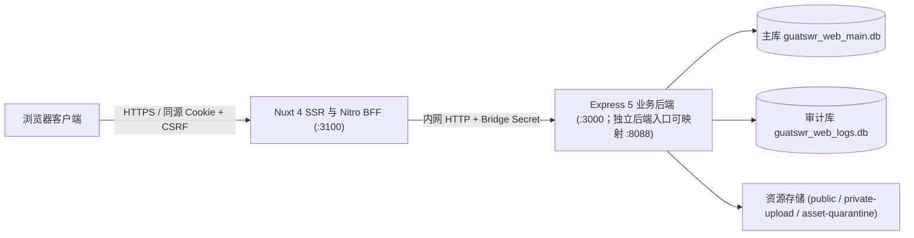
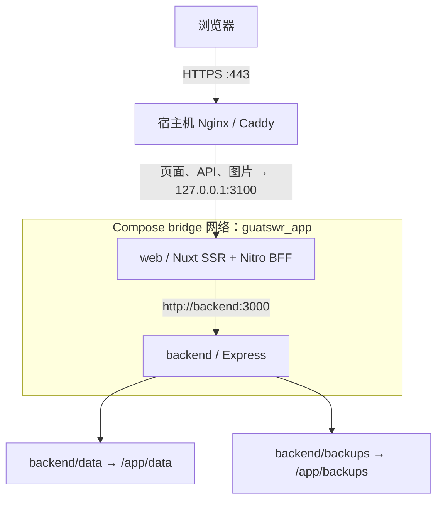

<a id="readme-top"></a>

<p align="center">
  
</p>

<h1 align="center">桂航绯想天 · GuatSWR Website</h1>

<p align="center">桂林航天工业学院东方同好社群网站</p>

<p align="center">
  <a href="https://github.com/guatswr/GuatSWR_Website/releases/tag/v2.0.0"></a>
  <a href="https://github.com/guatswr/GuatSWR_Website/actions/workflows/backend.yml?query=branch%3Amain"></a>
  <a href=".node-version"></a>
  <a href="web/package.json"></a>
  <a href="backend/package.json"></a>
  <a href="backend/package.json"></a>
</p>

<p align="center">
  <a href="#快速开始">快速开始</a> ·
  <a href="#本地调试指南">本地调试</a> ·
  <a href="#服务器部署教程">服务器部署</a> ·
  <a href="#后续运维">后续运维</a> ·
  <a href="docs/releases/v2.0.0.md">v2.0.0 版本说明</a> ·
  <a href="https://github.com/guatswr/GuatSWR_Website/issues">问题反馈</a>
</p>

本仓库包含桂航绯想天社群网站的公开前端、同源 BFF 服务层与 Express 业务后端。社团成员可浏览活动文章、投稿活动、报名STG与非想天则比赛、查阅成员列表与群史；管理员可通过后台审核投稿、录入赛果、管理成员与权限，并执行整站数据备份。

<details>
<summary>阅读目录</summary>

- [功能与页面](#功能与页面)
- [架构与工作区结构](#架构与工作区结构)
- [快速开始](#快速开始)
  - [1. 环境要求与依赖安装](#1-环境要求与依赖安装)
  - [2. 配置前后端环境变量](#2-配置前后端环境变量)
  - [3. 初始化双数据库与超级管理员](#3-初始化双数据库与超级管理员)
  - [4. 启动本地服务](#4-启动本地服务)
- [本地调试指南](#本地调试指南)
  - [1. 终端链路连通性自检](#1-终端链路连通性自检)
  - [2. 核心业务流程联调步骤](#2-核心业务流程联调步骤)
  - [3. 浏览器 Network 与后端日志关联排查](#3-浏览器-network-与后端日志关联排查)
  - [4. 修改文件后的热重载与重启规则](#4-修改文件后的热重载与重启规则)
  - [5. VS Code 后端 TypeScript 断点调试](#5-vs-code-后端-typescript-断点调试)
  - [6. 本地调试常见报错速查](#6-本地调试常见报错速查)
- [开发与质量门禁](#开发与质量门禁)
- [服务器部署教程](#服务器部署教程)
  - [1. 容器拓扑与网络边界](#1-容器拓扑与网络边界)
  - [2. 环境要求与持久化目录](#2-环境要求与持久化目录)
  - [3. 环境变量与 Compose 参数](#3-环境变量与-compose-参数)
  - [4. 构建与镜像版本管理](#4-构建与镜像版本管理)
  - [5. 数据库初始化与历史数据接管](#5-数据库初始化与历史数据接管)
  - [6. 启动与分层验收](#6-启动与分层验收)
  - [7. 生产 HTTPS 反向代理与业务验收](#7-生产-https-反向代理与业务验收)
  - [8. Windows 与局域网访问](#8-windows-与局域网访问)
  - [9. 日常管理、升级与故障排查](#9-日常管理升级与故障排查)
- [后续运维教程](#后续运维)
  - [1. 日常版本升级与平滑重启流程](#1-日常版本升级与平滑重启流程)
  - [2. 数据备份、完整性验包与灾难恢复](#2-数据备份完整性验包与灾难恢复)
  - [3. 文件隔离区与存储清理维护](#3-文件隔离区与存储清理维护)
  - [4. 账号安全、令牌撤销与审计日志维护](#4-账号安全令牌撤销与审计日志维护)
  - [5. 应急只读回退模式](#5-应急只读回退模式)
  - [6. 运维故障与残留锁文件处理](#6-运维故障与残留锁文件处理)
- [文档导航](#文档导航)

</details>

## 功能与页面

| 路由入口 | 页面职责 |
| --- | --- |
| `/` | 首页：社团简介、常驻企划方向、近期活动预告与往期回顾 |
| `/activities` · `/activity/:id` | 活动文章列表与正文（支持 Markdown、代码高亮、KaTeX 公式与 Mermaid 图表） |
| `/events` · `/events/:type` | 活动中心：悬赏令、非想天则、东方 STG、聚会、竞猜；支持游客草稿投稿、活动报名与赛果展示 |
| `/members` · `/history` | 住民名册（成员档案、院校分布）与群史时间轴 |
| `/social` · `/join` | 关联社群导航与入群迎新指引 |
| `/logs` | 经服务端投影与脱敏处理的公开站点操作日志 |
| `/login` · `/admin` | 管理员登录（支持二步验证密码）与后台：文章、活动审核、成员、群史、站点配置、账号权限与备份管理 |

公开页面由 Nuxt SSR 实时渲染（每次请求生成独立 CSP nonce，服务端数据层采用 SWR 缓存），支持深浅色主题切换、移动端适配与 `prefers-reduced-motion` 减弱动态效果。所有管理员操作与游客写操作均通过同源 Nitro BFF（`/api/bff/**`）完成鉴权、CSRF 校验、Origin 校验与请求体限流，后端签发的 JWT 密文仅保存在 BFF 服务端。

## 架构与工作区结构



```text
GuatSWR_Website/
├── web/                        # @guatswr/web：Nuxt 4 + Vue 3 + TypeScript 前端与 Nitro BFF
│   ├── app/                    # 页面路由、组件、Pinia 状态与客户端逻辑
│   ├── server/                 # BFF 鉴权、游客草稿网关、上传流式转发与公开数据 SWR 适配
│   └── tests/                  # 前端单测、BFF 集成测试与 Playwright E2E
├── backend/                    # guiair-backend：Express 5 + 严格 TypeScript 业务后端
│   ├── src/                    # 业务模块、双库迁移引擎、文件事务发布、隔离清理与备份调度
│   ├── scripts/                # 备份/恢复/验包工具（Bash + Python 3）、只读回退启动器与容器冒烟脚本
│   └── docs/openapi.yaml       # 后端 71 个操作的 OpenAPI 契约定义
├── packages/shared/            # @guatswr/shared：前后端共用的 Zod 4 校验契约（ESM / CJS 双产物）
├── scripts/                    # 仓库级备份入口包装、依赖安全审计、导入边界与路由体积预算检查
├── patches/                    # 经 SHA-256 锁定的上游依赖安全补丁
└── docs/                       # 架构说明、后端现代化运行手册（BM 系列）与前端改版验收记录
```

三个包共用根目录 `pnpm-lock.yaml`。后端业务层使用严格 TypeScript 编译至 `backend/dist/`，保留少量 CommonJS 平台装配层；主数据库（当前版本 `3`）与审计日志库（当前版本 `2`）各自维护独立的迁移账本。旧版 v1 前端源码保存在 Git 标签 `v1-archive` 中。

<p align="right">(<a href="#readme-top">返回顶部</a>)</p>

## 快速开始

以下步骤适用于**全新的本地空白开发环境**。若手头已有历史数据库文件，请先阅读[数据库迁移运行手册](docs/backend-modernization/MIGRATIONS.md)，切勿对非空历史库执行 `initialize`。

### 1. 环境要求与依赖安装

- **Node.js**：`24.16.0`（见 [`.node-version`](.node-version)，工作区限制 `>=24.16.0 <25`）
- **包管理器**：`pnpm@11.25.0`
- **原生编译与脚本工具**：`sqlite3` 与 `sharp` 含原生扩展，若预编译二进制未命中而回退源码编译，需安装 Python 3 与对应平台的 C/C++ 编译工具链（Windows Visual Studio C++ Build Tools / Linux `build-essential`）。执行完整备份与恢复脚本另需 `bash`、`python3`、`sqlite3` 命令行、`tar` 与 `sha256sum`。

克隆仓库并构建共享契约与后端产物：

```sh
git clone https://github.com/guatswr/GuatSWR_Website.git
cd GuatSWR_Website
npm install --global pnpm@11.25.0
pnpm install --frozen-lockfile
pnpm --filter @guatswr/shared build
pnpm --filter guiair-backend build
```

### 2. 配置前后端环境变量

首次运行时，将示例文件复制为本地 `.env`（`.env` 已被 Git 忽略，不会入库）：

```sh
cp backend/.env.example backend/.env
cp web/.env.example web/.env
```

本地调试建议将数据库、上传文件与备份全部放在 `backend/.data/` 隔离目录下，避免污染默认路径。先在仓库根目录打印两个隔离目录的绝对路径：

```sh
node -e "const p=require('node:path'); console.log('DATA_DIR='+p.resolve('backend/.data/dev')); console.log('BACKUP_ROOT='+p.resolve('backend/.data/dev-backups'))"
```

再连续执行以下命令 **3 次**，生成 3 组独立的 64 位十六进制随机密钥（分别用于 `JWT_SECRET`、`BFF_BRIDGE_SECRET` 与 `NUXT_SESSION_PASSWORD`）：

```sh
node -e "console.log(require('node:crypto').randomBytes(32).toString('hex'))"
```

编辑 `backend/.env`，填入刚才生成的绝对路径、密钥与初始超级管理员账号：

```dotenv
NODE_ENV=development
BIND_HOST=127.0.0.1
PORT=3000

# 填入上面打印的绝对路径（PUBLIC_DIR 默认解析为 DATA_DIR/public）
DATA_DIR=
BACKUP_ROOT=

# 填入第 1 组随机密钥
JWT_SECRET=
# 填入第 2 组随机密钥（必须与 web/.env 的 NUXT_BFF_BRIDGE_SECRET 完全一致）
BFF_BRIDGE_SECRET=

# 本地回环代理与站点地址
TRUST_PROXY_CIDRS=127.0.0.1/32,::1/128
SITE_URL=http://127.0.0.1:3100
CORS_ORIGINS=http://127.0.0.1:3100

# 仅供下一步 admin:bootstrap 显式创建首位超级管理员使用
SUPER_ADMIN_USERNAME=site-admin
SUPER_ADMIN_PASSWORD=ChangeMe_123456
```

编辑 `web/.env`，填入对应的后端地址与会话密钥：

```dotenv
NUXT_API_BASE=http://127.0.0.1:3000

# 填入第 3 组随机密钥（至少 32 个字符，不可与 JWT_SECRET 混用）
NUXT_SESSION_PASSWORD=
# 填入第 2 组随机密钥（与 backend/.env 的 BFF_BRIDGE_SECRET 完全一致）
NUXT_BFF_BRIDGE_SECRET=

# 允许本地回环地址发起写操作并在 HTTP 下写入会话 Cookie
NUXT_BFF_AUTH_ALLOWED_ORIGINS=["http://127.0.0.1:3100"]
NUXT_BFF_AUTH_TRUSTED_PROXY_CIDRS=[]
NUXT_BFF_AUTH_ALLOW_INSECURE_LOOPBACK_COOKIES=true

HOST=127.0.0.1
PORT=3100
```

<details>
<summary>核心环境变量说明表（点击展开）</summary>

| 变量名 | 所属端 | 校验规则与作用 |
| --- | --- | --- |
| `DATA_DIR` | Backend | 必填绝对路径。存放 `guatswr_web_main.db`、`guatswr_web_logs.db` 及私有上传/隔离目录 |
| `PUBLIC_DIR` | Backend | 公开静态资源绝对路径，默认 `$DATA_DIR/public`。严禁与 `DATA_DIR` 根、`BACKUP_ROOT` 或私有子目录重叠 |
| `BACKUP_ROOT` | Backend | 备份归档绝对路径，默认 `backend/backups`。不得位于 `PUBLIC_DIR` 内 |
| `JWT_SECRET` | Backend | 非空字符串，用于后端签发与校验业务 JWT |
| `BFF_BRIDGE_SECRET` | Backend | `32～256` 位可见 ASCII 字符。生产环境必填，用于校验来自 Nitro BFF 的游客草稿证明 |
| `GUEST_DRAFT_PROOF_MODE` | Backend | 默认 `required`（强制校验 BFF 桥接证明）；仅兼容过渡期可设为 `optional` |
| `TRUST_PROXY_CIDRS` | Backend | 逗号分隔的可信反向代理/BFF CIDR 列表；为空时不信任任何 `X-Forwarded-For` |
| `BACKUP_SCHEDULER_OWNER` | Backend | `app`（默认，由后端进程内置定时器按后台设置触发备份）或 `external`（由宿主机 cron 触发） |
| `SUPER_ADMIN_USERNAME` | Backend | `1～50` 位 ASCII 字母、数字、`_` 或 `-`；仅被 `admin:bootstrap` CLI 读取 |
| `SUPER_ADMIN_PASSWORD` | Backend | `6～100` 字符且 UTF-8 字节长度 `<= 72`（防止 bcrypt 静默截断）；仅被 `admin:bootstrap` CLI 读取 |
| `NUXT_API_BASE` | Web (BFF) | Nitro 服务端访问 Express 的内部 Origin（不带 `/api` 后缀，如 `http://127.0.0.1:3000`） |
| `NUXT_SESSION_PASSWORD` | Web (BFF) | 至少 32 位字符。通过 HKDF-SHA256 派生服务端 JWT 封存密钥（AES-256-GCM）与 CSRF 签名密钥 |
| `NUXT_BFF_BRIDGE_SECRET` | Web (BFF) | 必须与后端的 `BFF_BRIDGE_SECRET` 完全一致 |
| `NUXT_BFF_AUTH_ALLOWED_ORIGINS` | Web (BFF) | JSON 字符串数组（如 `["http://127.0.0.1:3100"]`）。写请求 `Origin` 必须精确匹配，否则返回 403 |
| `NUXT_BFF_AUTH_TRUSTED_PROXY_CIDRS` | Web (BFF) | JSON 字符串数组。仅当直接连接对端位于此 CIDR 内时才解析 `X-Forwarded-For` |
| `NUXT_BFF_AUTH_ALLOW_INSECURE_LOOPBACK_COOKIES` | Web (BFF) | 布尔值，默认 `false`。仅在非生产环境且连接与 `Host` 均为回环地址时允许明文 HTTP Cookie |

</details>

### 3. 初始化双数据库与超级管理员

后端服务在正常启动时**只做只读迁移账本与结构指纹校验**，不会自动建表、改表或创建管理员。首次启动前必须显式执行初始化命令。

先创建配置中的 `DATA_DIR` 目录：

```sh
node --env-file=backend/.env -e "require('node:fs').mkdirSync(process.env.DATA_DIR,{recursive:true})"
```

然后在仓库根目录按当前操作系统执行双库初始化（目标版本为 `main: 3`、`audit: 2`）与首位超级管理员创建：

<details open>
<summary>Windows PowerShell</summary>

```powershell
$devData = node --env-file=backend/.env -p "process.env.DATA_DIR"
pnpm --filter guiair-backend db:migrate initialize --data-dir $devData
pnpm --filter guiair-backend db:check --data-dir $devData
node --env-file=backend/.env backend/dist/src/admin/bootstrap-cli.js --main-db (Join-Path $devData 'guatswr_web_main.db')
```

</details>

<details>
<summary>Linux / macOS (Bash / Zsh)</summary>

```sh
DEV_DATA_DIR="$(node --env-file=backend/.env -p 'process.env.DATA_DIR')"
pnpm --filter guiair-backend db:migrate initialize --data-dir "$DEV_DATA_DIR"
pnpm --filter guiair-backend db:check --data-dir "$DEV_DATA_DIR"
node --env-file=backend/.env backend/dist/src/admin/bootstrap-cli.js --main-db "$DEV_DATA_DIR/guatswr_web_main.db"
```

</details>

执行成功后：
- `db:check` 会输出两行 JSON，`main` 的 `version` 为 `3`，`audit` 的 `version` 为 `2`。
- `bootstrap-cli.js` 首次创建会输出 `{"bootstrap":{"status":"created","username":"site-admin"}}`；对已存在的同名超级管理员重复执行会返回 `unchanged`，不会重置密码，也不会提升普通用户权限。

### 4. 启动本地服务

打开两个独立终端，均在仓库根目录运行：

**终端 1 — 启动 Express 业务后端（监听 `127.0.0.1:3000`）：**

```sh
pnpm --filter guiair-backend dev
```

**终端 2 — 构建共享包并启动 Nuxt 前台与 BFF（监听 `127.0.0.1:3100`）：**

```sh
pnpm dev
```

| 本地访问地址 | 说明 |
| --- | --- |
| [http://127.0.0.1:3100](http://127.0.0.1:3100) | 网站前台首页（**请统一使用 `127.0.0.1:3100` 而非 `localhost:3100`**，以匹配 `NUXT_BFF_AUTH_ALLOWED_ORIGINS`） |
| [http://127.0.0.1:3100/login](http://127.0.0.1:3100/login) | 管理员登录页（输入刚才初始化的 `SUPER_ADMIN_USERNAME` 与密码） |
| [http://127.0.0.1:3100/api/health](http://127.0.0.1:3100/api/health) | Nuxt / Nitro 进程存活探针 |
| [http://127.0.0.1:3000/api/version](http://127.0.0.1:3000/api/version) | 后端存活与契约版本接口（固定返回 `{"version":"4.0","status":"online"}`） |
| [http://127.0.0.1:3000/api/docs](http://127.0.0.1:3000/api/docs) | 后端 Swagger UI 接口文档 |

<p align="right">(<a href="#readme-top">返回顶部</a>)</p>

## 本地调试指南

在完成「快速开始」并保持前后端两个终端运行后，可按以下步骤在本地验证完整读写链路、设置断点与排查问题。

### 1. 终端链路连通性自检

打开第三个终端，依次探测后端存活、Nuxt 存活、SSR 公开读取适配以及 BFF 鉴权握手（Windows PowerShell 请使用 `curl.exe`，Linux/macOS 使用 `curl`）：

```powershell
# 1. 检查 Express 后端是否就绪（预期返回 {"version":"4.0","status":"online"}）
curl.exe -fsS http://127.0.0.1:3000/api/version

# 2. 检查 Nuxt 服务是否就绪（预期返回 200 OK）
curl.exe -fsS http://127.0.0.1:3100/api/health

# 3. 检查 Nuxt 服务端是否成功从后端拉取站点公开配置
curl.exe -fsS http://127.0.0.1:3100/api/config

# 4. 检查 BFF 会话状态与 CSRF 签发接口
curl.exe -fsS http://127.0.0.1:3100/api/bff/auth/session
curl.exe -fsS -i http://127.0.0.1:3100/api/bff/auth/csrf
```

若前两步成功而第 3 步报错，说明 `web/.env` 中的 `NUXT_API_BASE` 未指向正在运行的后端端口。

### 2. 核心业务流程联调步骤

空白开发库不含历史数据，建议按以下顺序验证四条核心业务链路：

1. **管理员登录与后台写操作（验证 BFF 会话与缓存失效）**
   - 浏览器访问 `http://127.0.0.1:3100/login`，使用初始化的超级管理员登录。
   - 进入 `/admin` 后台，在「活动文章」中新建并发布一篇测试文章（可插入 Markdown 标题、代码块与图片）。
   - 打开前台 `/activities` 与文章详情页，确认新文章已立即可见（验证 BFF 写操作成功后自动触发 `invalidatePublicData` 刷新服务端 SWR 缓存）。
2. **游客活动草稿投稿与流式上传（验证 Bridge 密钥与草稿归属）**
   - 打开一个**浏览器无痕窗口**访问 `http://127.0.0.1:3100/events`，点击发起活动投稿。
   - 此时前端会调用 `POST /api/bff/guest/events/draft` 创建草稿并写入 `HttpOnly` 草稿归属 Cookie（路径限制为 `/api/bff/guest`）。
   - 在表单中上传内容图片（走 `POST /api/bff/guest/upload/content`，BFF 校验文件前 256 字节魔数与 50 MiB 上限后流式转发至后端私有暂存区）并提交审核。
   - 切回普通窗口的 `/admin` 后台「活动管理」，审核通过该草稿，观察图片从私有暂存区原子发布到 `PUBLIC_DIR` 并在前台 `/events` 展示。
3. **活动报名与取消（验证报名截止规则与头像上传）**
   - 在后台创建一个状态为 `published` 或 `ongoing` 的 `东方STG` 或 `非想天则` 测试活动。
   - 在前台打开该活动详情，上传参赛头像（`POST /api/bff/guest/upload/avatar`）、填写报名表并提交（`POST /api/bff/guest/events/:id/signup`）。
   - 刷新页面确认当前访客报名信息正常回显，再点击取消报名（`DELETE /api/bff/guest/events/:id/signup`）验证状态清除。
4. **回收站彻底删除与文件隔离（验证 `asset_cleanup_jobs`）**
   - 在后台将测试文章或测试活动移入回收站并执行「永久删除」。
   - 检查 `backend/.data/dev/asset-quarantine/` 目录：被删除且无其他内容引用的上传图片不会立即从磁盘抹除，而是会在后台清理周期（每 30 秒一批）被原子 `rename` 到隔离区目录，供误删恢复使用。

### 3. 浏览器 Network 与后端日志关联排查

当页面提示请求失败时，不要直接猜测原因，按以下两步定位：

1. **查看浏览器 DevTools Network 面板**：筛选 `/api/bff/` 请求，查看响应状态码、返回体 `{"error":{"code":"...","message":"..."}}` 以及响应头中的 `X-Request-ID`。出于安全边界设计，BFF 会拦截并隐去所有上游原始报错堆栈、SQL 错误和敏感字段，仅向浏览器返回固定错误码。
2. **对照后端终端 Pino 结构化日志**：在运行 `guiair-backend` 的终端中查找同一个 `requestId`。后端日志会记录完整的事件类型：
   - `http.completed`：包含 `method`、`route`、`status` 与 `durationMs`
   - `http.failed`：包含未捕获路由异常或上游失败原因
   - `task.started` / `task.completed` / `task.failed`：后台异步任务（清理、审计投递、自动备份）执行情况
   - `audit.failed` / `backup.failed` / `storage.cleanup.retry`：子系统告警

> [!IMPORTANT]
> 反馈问题或贴出调试日志时，只保留 `X-Request-ID`、状态码与脱敏后的日志片段，切勿粘贴浏览器 `Cookie`、后端 `Authorization` 头、`JWT_SECRET`、`NUXT_SESSION_PASSWORD` 或 `BFF_BRIDGE_SECRET`。

### 4. 修改文件后的热重载与重启规则

不同目录的代码改动对运行中进程的影响不同：

| 修改的文件范围 | 生效方式与注意事项 |
| --- | --- |
| `web/app/**`（页面、组件、样式） | Vite / Nuxt HMR 自动热更新，无需重启，登录态保留 |
| `web/server/**`（Nitro BFF 路由、工具） | Nitro 会自动重载服务端模块，但**进程内存中的 BFF 登录会话与游客草稿归属表会被清空**；重载后需在浏览器重新登录或新建测试草稿 |
| `backend/src/**` 或 `backend/server.js` | `nodemon` 监听到 `.ts`/`.js`/`.json` 变化后，自动发送 `SIGTERM` 优雅停机、重新执行 `npm run build` 并重启后端 |
| `packages/shared/src/**`（共享 Zod 契约） | **不会自动跨包热编译**。修改后必须先运行 `pnpm --filter @guatswr/shared build`，再重启前后端开发终端，防止两端继续使用旧缓存产物 |
| `backend/.env` 或 `web/.env` | 环境变量仅在进程启动时读取，修改后需在对应终端按 `Ctrl+C` 停止并重新启动 |

### 5. VS Code 后端 TypeScript 断点调试

后端生产与常规开发构建默认不生成 Source Map。如需在 VS Code 中对 `backend/src/**/*.ts` 源码打断点单步调试：

**步骤 1：停止常规后端开发终端（避免 `3000` 端口冲突），在仓库根目录编译带内联 Source Map 的调试产物并启动 Inspector：**

```sh
pnpm --filter @guatswr/shared build
pnpm --filter guiair-backend build
pnpm --filter guiair-backend exec tsc -p tsconfig.build.json --sourceMap --inlineSources
node --env-file=backend/.env --inspect=127.0.0.1:9230 --enable-source-maps backend/dist/server.js
```

**步骤 2：在仓库根目录 `.vscode/launch.json` 中添加 Attach 配置：**

```json
{
  "version": "0.2.0",
  "configurations": [
    {
      "name": "Attach GuatSWR Backend (9230)",
      "type": "node",
      "request": "attach",
      "address": "127.0.0.1",
      "port": 9230,
      "sourceMaps": true,
      "outFiles": ["${workspaceFolder}/backend/dist/**/*.js"],
      "skipFiles": ["<node_internals>/**"]
    }
  ]
}
```

**步骤 3：在 VS Code「运行和调试」面板选择 `Attach GuatSWR Backend (9230)` 启动连接**，即可在 `backend/src/` 下的任意 `.ts` 文件中命中断点。

**步骤 4：调试结束后的清理**。调试端口仅可绑定 `127.0.0.1`。调试完毕后，按 `Ctrl+C` 停止进程，并重新运行一次标准构建以清除 `dist/` 中的调试 Source Map：

```sh
pnpm --filter guiair-backend build
```

### 6. 本地调试常见报错速查

<details>
<summary>点击展开本地常见问题与解决方法</summary>

1. **登录或提交表单时返回 `403 Forbidden`（错误码 `forbidden` 或 Origin 校验失败）**
   - **原因**：浏览器地址栏使用了 `http://localhost:3100`，而 `web/.env` 中配置的是 `NUXT_BFF_AUTH_ALLOWED_ORIGINS=["http://127.0.0.1:3100"]`。BFF 对 `Origin` 执行严格字符串全等匹配。
   - **解决**：统一使用 `http://127.0.0.1:3100` 访问，或将两个地址同时加入 `NUXT_BFF_AUTH_ALLOWED_ORIGINS` 的 JSON 数组中并重启 `pnpm dev`。
2. **登录接口返回 200，但跳转到 `/admin` 立即掉线回到 `/login`**
   - **原因**：会话 Cookie 默认带有 `Secure` 属性；在本地明文 HTTP 下若未开启回环豁免，浏览器会拒绝保存 Cookie。
   - **解决**：确认 `web/.env` 中已设置 `NUXT_BFF_AUTH_ALLOW_INSECURE_LOOPBACK_COOKIES=true`，且使用 `127.0.0.1` 回环地址访问。
3. **游客创建草稿或提交活动时返回 `403` / `502`**
   - **原因**：`backend/.env` 的 `BFF_BRIDGE_SECRET` 与 `web/.env` 的 `NUXT_BFF_BRIDGE_SECRET` 不一致，或密钥长度不足 32 位可见 ASCII 字符。
   - **解决**：核对两端密钥是否完全相同，修改后同时重启后端与 Nuxt。
4. **后端启动立即退出并报 `MIGRATION_REQUIRED` 或 `MIGRATION_SCHEMA_DRIFT`**
   - **原因**：`DATA_DIR` 指向了尚未初始化的空目录，或本地代码更新了数据库迁移版本但开发库尚未升级。
   - **解决**：空目录执行 `db:migrate initialize`；已有开发库执行 `pnpm --filter guiair-backend db:migrate upgrade --data-dir <绝对路径>`。
5. **后端启动报 `Invalid configuration: STORAGE_LAYOUT`**
   - **原因**：`PUBLIC_DIR`、`DATA_DIR` 与 `BACKUP_ROOT` 之间存在目录包含关系（例如把 `BACKUP_ROOT` 放在了 `PUBLIC_DIR` 内，或把 `PUBLIC_DIR` 设为了 `DATA_DIR` 本身），或者主库与日志库指向了同一个文件。
   - **解决**：确保 `DATA_DIR` 与 `BACKUP_ROOT` 是相互独立的绝对路径，`PUBLIC_DIR` 保持默认（即 `$DATA_DIR/public`）或指向完全独立的静态目录。

</details>

<p align="right">(<a href="#readme-top">返回顶部</a>)</p>

## 开发与质量门禁

所有工作区检查命令均在**仓库根目录**运行：

| 命令 | 检查范围与说明 |
| --- | --- |
| `pnpm typecheck` | 先构建 `@guatswr/shared`，再对全工作区执行严格 TypeScript 类型检查 |
| `pnpm lint` | 运行全工作区 ESLint 检查（后端限制 `--max-warnings=0`） |
| `pnpm test` | 运行 `shared`、`web` 与 `backend` 的单元测试、契约测试与集成测试 |
| `pnpm --filter guiair-backend test:unit` | 单独运行后端引导测试与单元测试 |
| `pnpm --filter guiair-backend test:contracts` | 单独运行后端 OpenAPI 与共享契约一致性测试 |
| `pnpm --filter guiair-backend test:integration` | 单独运行后端 SQLite / 上传 / 鉴权集成测试 |
| `pnpm --filter guiair-backend test:bff` | 真实 Nuxt BFF 产物 + 真实 Express 后端端到端联测（**运行前须先执行 `pnpm --filter @guatswr/web build`**） |
| `pnpm test:tooling` | 运行仓库边界检查器、路由体积检查器、安全补丁探针与隔离 E2E 执行器自测 |
| `pnpm check:boundaries` | 校验浏览器端、Nitro 服务端与共享包之间的模块导入边界 |
| `pnpm check:security` | 校验 `patches/` 补丁 SHA-256 与漏洞修复探针，并执行 pnpm 在线安全审计 |
| `pnpm build` | 构建 `shared`、`web` 与 `backend` 全部生产产物 |
| `pnpm check:artifacts` | 校验构建产物完整性（无残留 Source Map、私有配置未混入客户端 bundle 等，需先 `pnpm build`） |
| `pnpm check:routes` | 启动无头浏览器测量各公开路由初始 JS 体积预算（需先 `pnpm build` 并安装 Chromium） |

**运行 Playwright 隔离 E2E 测试：**

E2E 测试会在 `3100`、`3181`、`3182` 端口启动隔离测试服务与合成数据夹具，不会触碰本地开发数据库。运行前请确保上述三个端口未被占用：

```sh
pnpm build
pnpm --filter @guatswr/web exec playwright install chromium
pnpm test:e2e
```

> [!NOTE]
> 在 Linux 主机上运行 Playwright E2E 或 Lighthouse 性能采集（`pnpm --filter @guatswr/web test:performance`）前，需先安装中文字体与浏览器系统依赖：`sudo apt-get update && sudo apt-get install -y fonts-noto-cjk && pnpm --filter @guatswr/web exec playwright install --with-deps chromium`。

<p align="right">(<a href="#readme-top">返回顶部</a>)</p>

## 服务器部署教程

本节以仓库根目录的 [`docker-compose.yml`](docker-compose.yml) 为标准部署入口：前端 `web` 与后端 `backend` 分别构建、分别运行，通过 Docker 网络连接。生产示例面向 Linux 服务器；Windows Docker Desktop 的局域网使用方式见第 8 节。正式发布还应对照 [发布检查清单](docs/backend-modernization/RELEASE-CHECKLIST.md) 和 [生产运行手册](docs/backend-modernization/RUNTIME-RUNBOOK.md)。

首次部署顺序为：**准备目录 → 配置环境变量 → 构建镜像 → 初始化或迁移数据库 → 启动容器 → 配置 HTTPS 并验收**。后文命令默认在仓库根目录执行；Linux 使用 Bash，标为 `powershell` 的命令用于 Windows PowerShell。

### 1. 容器拓扑与网络边界



| 项目 | `web` | `backend` |
| --- | --- | --- |
| 构建文件 | [`web/Dockerfile`](web/Dockerfile) | [`backend/Dockerfile`](backend/Dockerfile) |
| 构建上下文 | 仓库根目录 `.` | 仓库根目录 `.` |
| 默认镜像 | `guatswr-web:local` | `guatswr-backend:local` |
| 容器监听 | `0.0.0.0:3100` | `0.0.0.0:3000` |
| 默认宿主机发布 | `127.0.0.1:3100 → 3100` | 无 `ports` 映射 |
| 运行配置 | `web/.env.production` | `backend/.env` |
| 健康探针 | `/api/health` | `/api/version`，并检查 `status=online` |
| 持久化目录 | 无业务数据卷 | `/app/data`、`/app/backups` |

当前架构按**一个 Web 实例、一个后端实例**运行。BFF 会话与游客草稿归属保存在进程内存中，SQLite 使用单写锁；在引入共享会话、草稿存储并重新验证写入协调前，不应直接水平扩展服务。

浏览器只访问前端同源入口。`/api/*` 由 Nuxt 数据接口或 BFF 处理，`/uploads/*` 由 Nuxt 的图片代理读取后端资源。反向代理应把这些路径一并交给 `web`，不要将 `/api/` 直接转发到 Express。

两个服务共享 Compose 创建的专用 bridge 网络。`backend` 是 Docker 服务名，Nuxt 的服务端通过 `http://backend:3000` 访问它；容器间通信不依赖宿主机 `8088` 端口、`host.docker.internal` 或宿主机回环。该地址属于私有运行配置，不应放入浏览器端配置。

此网络保留后端访问 Bot/Webhook 等外部服务的出站能力，未设置 `internal: true`。后端没有宿主机端口发布；同一 Docker 网络内的其他容器仍可能连接它，访客写入还需要桥接密钥和受信任代理校验。

默认网络参数为子网 `172.30.88.0/24`、网关 `172.30.88.1`、Web 容器地址 `172.30.88.10`。后端仅信任 Web 的 `/32` 地址，前端默认信任 bridge 网关的 `/32` 地址。实际代理对端可能因 Docker Desktop、额外反向代理或网络模式而变化，上线前应按实际链路核对；不要将受信任代理范围扩大到所有来源。

根目录 Compose 的项目名默认为 `guatswr`，容器名通常为 `guatswr-web-1`、`guatswr-backend-1`。下文使用服务名执行命令，不依赖自动生成的容器名。已有的 [`backend/docker-compose.yml`](backend/docker-compose.yml) 是**独立后端入口**，发布宿主机回环 `8088`；完整双容器部署使用根目录文件。切换前停止旧服务，避免两套后端同时写入同一组数据库。

### 2. 环境要求与持久化目录

#### 2.1 Docker 环境

需要支持 Linux 容器和多阶段构建的 Docker Engine/Docker Desktop，以及支持 `up --wait` 和健康依赖的 Docker Compose 插件。本文使用 `docker compose` 命令。先确认 Docker 服务已启动：

```sh
docker version
docker compose version
```

使用容器构建和运行时，宿主机不需要安装 Node.js、pnpm、SQLite 或 Python。构建会下载基础镜像、系统软件包和 pnpm 依赖，并执行前端安全检查；构建机需能访问对应软件源。密钥生成示例使用 OpenSSL，也可使用密码管理器生成高熵随机密钥。

#### 2.2 Linux 目录与权限

以下示例假设仓库位于 `/srv/guatswr/repo`。镜像以非 root 用户 `node` 运行，UID/GID 为 `1000:1000`。Compose 的 bind mount 设置了 `create_host_path: false`，必须提前创建源目录并授予运行用户读写权限：

```sh
cd /srv/guatswr/repo
sudo mkdir -p backend/data/public backend/backups /srv/guatswr/verify-work
sudo chown -R 1000:1000 backend/data backend/backups /srv/guatswr/verify-work
sudo chmod 700 backend/data backend/backups /srv/guatswr/verify-work
sudo chmod 755 backend/data/public
```

上述命令用于新目录。旧状态目录应先停写并备份，再修正准确的目标路径。容器启动不会自动对挂载卷执行递归 `chown`。

| 宿主机默认目录 | 容器路径 | 内容 |
| --- | --- | --- |
| `backend/data` | `/app/data` | 主库、审计库、私有上传、隔离区、文件发布恢复状态 |
| `backend/data/public` | `/app/data/public` | 通过 `/uploads/*` 提供的公开图片；它是数据卷内的子目录 |
| `backend/backups` | `/app/backups` | 数据库、资源和全量备份归档 |

`data/public`、`data/asset-quarantine`、`data/asset-publications` 应与 `data` 保持在同一个本地文件系统，以支持原子文件移动。不要另行将 `public` 子目录挂载到不同文件系统，也不要把数据库、备份或私有上传目录放进公开资源树。

Windows Docker Desktop 使用工作区下的 `backend/data`、`backend/backups` 作为 bind mount 时，应先创建目录，并确认 Docker Desktop 有权访问该磁盘。Linux 的 `chown/chmod` 命令不适用于 Windows ACL；数据库与资源仍应位于本地磁盘，避免放在网络共享或同步盘中。

### 3. 环境变量与 Compose 参数

#### 3.1 区分两层配置

| 配置层 | 默认文件 | 用途 |
| --- | --- | --- |
| Compose 插值 | 仓库根目录 `.env`，或命令行 `--env-file` 指定的文件 | 选择镜像标签、发布地址、网络、配置文件路径与数据卷源路径 |
| 容器进程环境 | `backend/.env`、`web/.env.production`，通过服务的 `env_file` 注入 | JWT、BFF 桥接密钥、会话密钥、站点 Origin、业务配置 |

`docker compose --env-file deploy.env ...` 指定的是 **Compose 插值文件**，不会自动替代服务的 `env_file`。若要选择其他业务配置文件，应在插值文件中设置 `BACKEND_ENV_FILE`、`WEB_ENV_FILE`。所有命令应复用同一个项目名、插值文件和 `-f` 文件列表；本机局域网的具体例子见第 8.3 节。

Nuxt 生产产物 `node .output/server/index.mjs` 不会自动加载 `web/.env`。密钥必须通过 Compose 等方式注入运行进程；修改配置文件后，需要重新创建容器才能生效。

#### 3.2 后端配置：`backend/.env`

首次创建时复制模板；已有配置应原位检查并补齐，避免覆盖历史密钥：

```sh
cp backend/.env.example backend/.env
chmod 600 backend/.env
```

编辑为实际部署配置。下列两个密钥必须填写；全新部署建议各使用独立的 32 字节随机值，例如分别执行 `openssl rand -hex 32`：

```dotenv
NODE_ENV=production
JWT_SECRET=
BFF_BRIDGE_SECRET=
GUEST_DRAFT_PROOF_MODE=required
SITE_URL=https://guatswr.top
CORS_ORIGINS=https://guatswr.top
MAX_BODY_SIZE=50mb
STAGING_TTL_MS=172800000
BACKUP_SCHEDULER_OWNER=app
```

将站点域名改为实际 HTTPS Origin。`BFF_BRIDGE_SECRET` 必须为 32～256 个可见 ASCII 字符，并与前端 `NUXT_BFF_BRIDGE_SECRET` 一致；保留已有部署的 `JWT_SECRET`。Bot/Webhook 等可选配置按 [`backend/.env.example`](backend/.env.example) 补充，不需要启用的集成可保持关闭。

Compose 会覆盖后端的 `NODE_ENV=production`、`PORT=3000`、`BIND_HOST=0.0.0.0`、容器内存储路径与 `TRUST_PROXY_CIDRS`。不要用修改 `backend/.env` 的 `PORT` 来调整宿主机入口。

#### 3.3 前端配置：`web/.env.production`

```sh
cp web/.env.example web/.env.production
chmod 600 web/.env.production
```

编辑以下配置；会话密钥与 JWT、桥接密钥应分别生成：

```dotenv
NUXT_API_BASE=http://backend:3000
NUXT_SESSION_PASSWORD=
NUXT_BFF_BRIDGE_SECRET=
NUXT_BFF_AUTH_ALLOWED_ORIGINS=["https://guatswr.top"]
NUXT_BFF_AUTH_ALLOW_INSECURE_LOOPBACK_COOKIES=false
```

`NUXT_SESSION_PASSWORD` 至少 32 个字符；`NUXT_BFF_BRIDGE_SECRET` 填入后端同一个桥接密钥。允许写入的 Origin 使用精确的协议、域名和端口，不带路径；多个 Origin 用 JSON 数组表示。外网和局域网的非回环地址均应使用 HTTPS，生产模式会话 Cookie 保持 `Secure`。

根目录 Compose 固定覆盖 `NODE_ENV`、`HOST`、`PORT`、`NUXT_API_BASE` 和 `NUXT_BFF_AUTH_TRUSTED_PROXY_CIDRS`。其中代理信任配置以 Compose 的 `environment` 为准，在 `web/.env.production` 中设置同名变量不会覆盖它。若实际代理对端与默认网关不同，应通过额外的 Compose override 文件精确修改该列表。

#### 3.4 Compose 插值参数

可在根目录 `.env` 或独立的部署插值文件中配置下列参数。相对的 `env_file` 和 bind mount 路径按 Compose 文件的项目目录解析；多个 `-f` 文件合并时，以第一个 Compose 文件所在目录为基准。

| 参数 | 默认值 | 说明 |
| --- | --- | --- |
| `BACKEND_SOURCE_REVISION` | 镜像标签 `local`；后端修订标签 `unknown` | 同时用于两个镜像的 tag；后端另写入 OCI `org.opencontainers.image.revision` |
| `WEB_BIND_ADDRESS` | `127.0.0.1` | 宿主机发布地址；对局域网开放时设为本机实际网卡 IPv4 |
| `WEB_PORT` | `3100` | 宿主机前端端口，容器内仍为 `3100` |
| `DOCKER_SUBNET` | `172.30.88.0/24` | 专用 bridge 子网；需避开宿主机、VPN 与已有 Docker 网络 |
| `DOCKER_GATEWAY` | `172.30.88.1` | 上述子网内的网关；同时用于前端默认代理信任列表 |
| `DOCKER_WEB_IP` | `172.30.88.10` | 同一子网内的固定 Web 地址；后端信任其 `/32` |
| `BACKEND_ENV_FILE` | `./backend/.env` | 后端业务配置文件 |
| `WEB_ENV_FILE` | `./web/.env.production` | 前端业务配置文件 |
| `BACKEND_DATA_DIR` | `./backend/data` | 数据 bind mount 源目录，必须存在 |
| `BACKEND_BACKUP_DIR` | `./backend/backups` | 备份 bind mount 源目录，必须存在 |
| `IMAGE_REGISTRY` | 空 | 仅作用于后端 Dockerfile 的基础镜像前缀；非空时需含结尾 `/`，镜像源需支持所固定的 digest |
| `COMPOSE_PROJECT_NAME` | 文件中的项目名 `guatswr` | Docker Compose 标准项目名覆盖；相关命令需保持一致 |

例如，默认 Docker 子网冲突时应同时调整三个网络参数：

```dotenv
DOCKER_SUBNET=172.30.90.0/24
DOCKER_GATEWAY=172.30.90.1
DOCKER_WEB_IP=172.30.90.10
WEB_BIND_ADDRESS=127.0.0.1
WEB_PORT=3100
```

容器内存储路径始终使用 `/app/data`、`/app/data/public`、`/app/backups`，不会随宿主机源目录变化。部署配置和密钥不应提交到 Git；根目录 `.dockerignore` 会排除环境文件、本地数据、备份及构建缓存。

### 4. 构建与镜像版本管理

配置文件与目录准备完成后，从仓库根目录执行：

```sh
cd /srv/guatswr/repo
export BACKEND_SOURCE_REVISION="$(git rev-parse HEAD)"
docker compose config --quiet
docker compose build
```

生产构建应使用明确的 Git 修订与已审核源码；`BACKEND_SOURCE_REVISION` 只是标记，不会验证工作区是否包含未提交改动。镜像标签默认只保存在本机构建机，Compose 不会自动把镜像推送到镜像仓库。

前后端均为多阶段镜像。后端构建共享包与编译产物，通过 `pnpm deploy --prod` 安装生产依赖；前端依次执行依赖安全检查、类型检查、lint、单元测试、生产构建和产物检查。前端契约测试只在构建阶段读取后端路由声明，最终运行镜像仅复制 Nuxt `.output`，不携带后端应用。

构建失败应先阅读第一个失败步骤的日志。不要通过跳过测试或复制宿主机 `node_modules` 绕过构建问题。两个 Dockerfile 都依赖根目录工作区文件，单独构建也必须使用根目录作为上下文：

```sh
docker compose build backend
docker compose build web
```

若已有与本次配置标签一致的镜像，可在后续启动时使用 `--no-build`。没有显式修订时会使用 `:local`，适合本地验证；正式发布应固定并记录修订标签。

### 5. 数据库初始化与历史数据接管

应用启动只校验迁移状态，不会自动创建可用数据库、接管历史库或执行升级。下列命令通过一次性的后端容器运行：`--no-deps` 不启动其他服务，`--rm` 在命令结束后移除临时容器；挂载目录中的数据会保留。

根据数据状态只选择一条路径：**全新空库使用 `initialize`；无迁移账本的兼容历史库使用 `inspect → adopt`；已有迁移账本使用 `upgrade`。** 当前仓库声明的最新版本为主库 `7`、审计库 `2`，实际应以所部署修订的迁移清单与 `check` 输出为准。

#### 5.1 全新空库

```sh
docker compose run --rm --no-deps backend \
  node dist/src/migrations/cli.js initialize --data-dir /app/data
docker compose run --rm --no-deps backend \
  node dist/src/migrations/cli.js check --data-dir /app/data
```

接着显式创建首位超级管理员。以下 Bash 命令交互读取凭据，密码不回显，也不直接出现在命令参数中：

```bash
read -r -p '超级管理员用户名: ' SUPER_ADMIN_USERNAME
read -r -s -p '超级管理员密码: ' SUPER_ADMIN_PASSWORD
printf '\n'
export SUPER_ADMIN_USERNAME SUPER_ADMIN_PASSWORD
docker compose run --rm --no-deps \
  -e SUPER_ADMIN_USERNAME -e SUPER_ADMIN_PASSWORD backend \
  node dist/src/admin/bootstrap-cli.js --main-db /app/data/guatswr_web_main.db
unset SUPER_ADMIN_USERNAME SUPER_ADMIN_PASSWORD
```

用户名支持 1～50 个英文字母、数字、下划线或连字符；密码长度为 6～100 个字符，UTF-8 编码不超过 72 字节，实际部署应选用高强度密码。引导命令用于创建首位管理员，不会重置已有密码，也不会把已有普通账号提升为超级管理员。已有管理员的数据接管跳过此步骤。

#### 5.2 无账本历史库：检查并显式接管

先停止旧容器、原生后端、定时任务和其他写入口，完成停写备份，并在隔离副本上演练；详见[数据备份与灾难恢复](#2-数据备份完整性验包与灾难恢复)。SQLite WAL 模式可能有尚未合并的 `-wal` 数据，不能只复制两个 `.db` 文件作为完整恢复点，也不要擅自删除 `-wal`、`-shm`。公开资源和私有状态应按备份运行手册一并保全。

仅当旧后端确实由独立 Compose 入口管理时，可用以下命令停止它：

```sh
docker compose -f backend/docker-compose.yml stop
```

确认实际数据已放入根目录 Compose 挂载的数据目录，然后获取双库指纹：

```sh
docker compose run --rm --no-deps backend \
  node dist/src/migrations/cli.js inspect --data-dir /app/data
```

将本次 `inspect` 输出的两个 `fingerprint` 原样填入交互提示。指纹必须来自当前待接管数据库，不能复用其他环境或 README 中的示例：

```bash
read -r -p 'main fingerprint: ' MAIN_FINGERPRINT
read -r -p 'audit fingerprint: ' AUDIT_FINGERPRINT
docker compose run --rm --no-deps backend \
  node dist/src/migrations/cli.js adopt --data-dir /app/data \
  --main-fingerprint "$MAIN_FINGERPRINT" \
  --audit-fingerprint "$AUDIT_FINGERPRINT"
unset MAIN_FINGERPRINT AUDIT_FINGERPRINT
docker compose run --rm --no-deps backend \
  node dist/src/migrations/cli.js check --data-dir /app/data
```

`adopt` 仅支持迁移引擎识别的历史结构；指纹确认不能替代结构校验。主库和审计库分别提交事务，某一个失败时应检查两者状态，再按运行手册处理；不要重复 `initialize` 或手工改写迁移账本来跳过错误。

#### 5.3 已有迁移账本：显式升级

完成停写备份后，使用**新版本后端镜像**执行升级与校验：

```sh
docker compose run --rm --no-deps backend \
  node dist/src/migrations/cli.js upgrade --data-dir /app/data
docker compose run --rm --no-deps backend \
  node dist/src/migrations/cli.js check --data-dir /app/data
```

升级数据库不等同于可逆操作。回退镜像前应核实旧代码与当前库结构的兼容性；需要恢复时，按恢复手册还原到新目录并验证，再切换挂载路径。

### 6. 启动与分层验收

#### 6.1 启动两个服务

```sh
docker compose up -d --no-build --wait --wait-timeout 120
docker compose ps
docker compose logs --tail=100 backend web
```

`web` 声明了 `depends_on: backend: condition: service_healthy`，首次创建时先等待后端健康再启动前端。两镜像探针默认每 30 秒检查一次，启动宽限期 15 秒，超时 3 秒，连续失败 3 次转为 `unhealthy`。`web` 的 `/api/health` 仅检查自身存活，不能代替后端连通性验收。

Compose 的健康依赖负责启动顺序，后端后续变为 `unhealthy` 不会自动连带重启前端；`restart: unless-stopped` 针对容器退出生效，不会仅因健康状态失败而重启进程。两容器还配置了 init、移除全部 Linux capabilities、禁止提权及 30 秒停止宽限期。

#### 6.2 检查前端入口与 Docker 内部链路

默认发布到宿主机回环时：

```sh
curl -fsS http://127.0.0.1:3100/api/health
curl -fsS http://127.0.0.1:3100/api/config
docker compose exec web node -e "fetch('http://backend:3000/api/version').then(async r => { console.log(await r.text()); process.exit(r.ok ? 0 : 1) }).catch(() => process.exit(1))"
```

验收时应同时满足：两个服务均为 `healthy`；前端 `/api/config` 能读取后端数据；Web 容器通过服务名访问后端成功；`docker compose ps` 中后端只有 `3000/tcp` 的容器端口说明，没有宿主机 `HOST:PORT->3000/tcp` 映射。

如果修改了 `WEB_BIND_ADDRESS` 或 `WEB_PORT`，上述宿主机探针应改用实际地址和端口。直接检查后端自身探针也可执行：

```sh
docker compose exec backend node scripts/healthcheck.cjs
```

### 7. 生产 HTTPS 反向代理与业务验收

#### 7.1 Nginx 配置示例

生产入口使用有效证书，并将所有请求转发到 Nuxt。下面假设 Nginx 运行在宿主机上，且 `WEB_BIND_ADDRESS=127.0.0.1`、`WEB_PORT=3100`；域名与证书路径需按部署环境修改。

```nginx
server {
    listen 80;
    server_name guatswr.top;
    return 301 https://$host$request_uri;
}

server {
    listen 443 ssl;
    server_name guatswr.top;

    ssl_certificate     /etc/nginx/ssl/guatswr.top.pem;
    ssl_certificate_key /etc/nginx/ssl/guatswr.top.key;

    # 允许 50 MiB 文件和 multipart 头部开销通过
    client_max_body_size 52m;

    location / {
        proxy_pass http://127.0.0.1:3100;
        proxy_http_version 1.1;
        proxy_set_header Host $http_host;
        proxy_set_header X-Forwarded-For $proxy_add_x_forwarded_for;
        proxy_set_header X-Forwarded-Proto $scheme;
        proxy_read_timeout 60s;
    }
}
```

单次备份下载可能超过普通请求的 60 秒，若使用大备份包，应按实际下载时长调高对应反向代理的读取超时。配置修改后先执行 `nginx -t`，通过后再重载服务。

若 Nginx/Caddy 自身运行在容器中，它的 `127.0.0.1` 指向代理容器自身。此时需另外设计代理网络、通过服务名访问 `web:3100`，并调整 Web 的受信任代理列表；上述宿主机配置不能原样套用。CDN/多级代理也应逐层核对真实客户端地址与转发头。

#### 7.2 完整业务验收

通过最终 HTTPS Origin 在浏览器逐项确认：

- [ ] 首页、活动文章、活动中心、住民和群史页面正常，已有 `/uploads/*` 图片可以读取。
- [ ] `/login` 能登录原管理员账号，`guatswr-next` Cookie 具备 `HttpOnly; Secure; SameSite=Lax`。
- [ ] 无痕窗口能创建游客草稿、上传图片并报名；管理员审核后公开页数据及时刷新。
- [ ] 后台可以生成、下载和验证备份；确认预定的自动备份调度所有者与首次执行结果。
- [ ] 页面 HTML 和 `/api/*` 不被 CDN 复用缓存，携带 CSP nonce 的 HTML 和私有会话响应不进入共享缓存。

技术探针成功不代表上述业务全部验收完成；公开站点的索引、robots 与 sitemap 也应按独立发布检查清单核实。

### 8. Windows 与局域网访问

#### 8.1 开放前端的局域网 HTTP 入口

在部署插值文件中设置本机当前局域网 IPv4。例如 `192.168.1.100` 只是网络示例，必须替换为 `ipconfig` 显示的实际地址：

```dotenv
WEB_BIND_ADDRESS=192.168.1.100
WEB_PORT=3100
```

然后使用同一套 Compose 参数执行 `up -d` 重新创建 Web 容器。其他设备通过 `http://实际IP:3100` 浏览公开页面。仅设置 `HOST=0.0.0.0` 不会改变宿主机端口发布地址；应调整 `WEB_BIND_ADDRESS`。

连接不通时，依次确认网卡 IP 未变化、端口已监听、Windows 防火墙允许 Docker Desktop 对当前网络配置接收入站连接，以及 Wi-Fi 未开启客户端隔离。放通规则应限定必要端口和可信局域网范围，不需要开放后端 `3000`。Windows 的网络类别可能为 `Public`，只配置 `Private` 规则不一定生效。

#### 8.2 登录和提交需要 HTTPS

项目拒绝把非回环 HTTP 地址配置为允许写入的 Origin；生产模式还会强制使用 Secure Cookie。局域网 HTTP 页面能够打开，并不代表管理员登录和游客写入可用。不要通过把 `http://局域网IP:3100` 加入允许列表来绕过这个限制。

完整功能应使用以下任一方式提供 HTTPS：为局域网域名配置可信证书；使用自建 CA 并在访问设备中安装信任；或在临时调试环境使用含实际 IP SAN 的自签名证书并明确处理浏览器证书提示。TLS 入口的精确 Origin（包含非默认端口）必须加入 `NUXT_BFF_AUTH_ALLOWED_ORIGINS`，然后重新创建 Web 容器。

#### 8.3 本机已有的双容器局域网配置

<details>
<summary>2026-10-28 核对的本机配置与管理命令</summary>

本工作区已创建下列**本机文件**。它们位于被 Git 忽略的目录或环境文件中，不会随仓库克隆分发；其他机器应按前文重新准备，不能假设这些文件和镜像存在。

| 本机文件 | 用途 |
| --- | --- |
| `.tools/lan-deployment/compose.env` | 选择本机已构建的 `compose-validation` 镜像标签，并绑定局域网 IPv4 |
| `.tools/lan-deployment/lan-compose.yml` | 在现有 Web 容器中附加 HTTPS 代理，发布 `3443`，仍保持两个应用容器 |
| `.tools/lan-deployment/tls/proxy.mjs` | 将 TLS 请求转发到同一 Web 容器内的 `127.0.0.1:3100` |
| `.tools/lan-deployment/tls/server.crt`、`server.key` | 本机 TLS 证书与私钥，通过只读 bind mount 提供给 Web |
| `web/.env.production` | 本机前端密钥与 HTTPS Origin 配置 |
| `.tools/lan-deployment/data-original` | 接管前保全的原始数据副本；不是自动备份任务的输出目录 |

本机当次配置的公开页面入口为 `http://10.39.107.86:3100`，HTTPS 入口为 `https://10.39.107.86:3443`。这是当前机器的地址，不是仓库默认地址。证书 SAN 包含该 IP，有效期至 **2026-11-26 17:26（北京时间）**，未配置自动续期。首次访问会出现自签名证书提示；长期使用应建立客户端信任并安排续期。IP 变化后还需同步修改绑定地址、TLS 发布地址、证书 SAN 和允许的 Origin。

在仓库根目录使用以下 PowerShell 参数管理该部署：

```powershell
$lanCompose = @(
  '--env-file', '.tools/lan-deployment/compose.env',
  '-f', 'docker-compose.yml',
  '-f', '.tools/lan-deployment/lan-compose.yml'
)

docker compose @lanCompose ps
docker compose @lanCompose logs --tail=100 backend web

# 配置检查后重建容器，复用本机已有镜像
docker compose @lanCompose config --quiet
docker compose @lanCompose up -d --no-build --wait --wait-timeout 120
```

`compose-validation` 是这台机器已有镜像的本地标签，不是发布版本号，也不是远程可拉取的镜像。需要部署新源码时，应先构建对应镜像，再按第 9 节的停写与迁移流程切换。

这套 HTTPS 代理用于本机局域网验证，没有独立的 TLS 健康探针或进程监督；Web 容器为 `healthy` 不能证明 `3443` 可用。应单独检查 HTTPS 页面、证书和登录流程，并复核代理信任与真实客户端 IP。正式生产使用第 7 节的反向代理方案。

当次检查确认双容器健康、Docker 内部 API 可达，且本机通过局域网 IP 的 HTTP/HTTPS 页面与登录请求校验正常；其他设备的实际可达性仍需在同一网络中验证。后端依然不发布宿主机端口。

</details>

### 9. 日常管理、升级与故障排查

#### 9.1 常用管理命令

以下为根目录默认部署示例；使用自定义 `--env-file` 或 override 时应给每一条命令带上同样参数：

| 操作 | 命令与影响 |
| --- | --- |
| 查看状态 | `docker compose ps` |
| 跟踪日志 | `docker compose logs -f --tail=100 backend web` |
| 重启进程 | `docker compose restart web`；沿用原容器环境，不加载新 `env_file` |
| 应用前端环境修改 | `docker compose up -d --no-build --force-recreate web` |
| 应用源码修改 | `docker compose build` 后按升级步骤启动新镜像 |
| 停止服务 | `docker compose stop`；保留容器和数据 |
| 移除服务容器与项目网络 | `docker compose down`；本项目 bind mount 的宿主机数据、资源与备份目录保留 |

重启或重建前端会清空其进程内会话与游客草稿归属记录，用户可能需要重新登录或创建未完成草稿。根目录 Compose 的后端停止宽限期为 30 秒，默认应用退出超时为 15 秒；如果调整 `SHUTDOWN_TIMEOUT_MS`，应同步保证 `stop_grace_period` 足够完成退出。

备份工具已包含在后端镜像中，可直接执行在线全量备份，无需在宿主机另装 SQLite/Python：

```sh
docker compose exec backend bash scripts/backup_all.sh
```

在线备份标记为 `online-per-resource`，用于日常恢复，不表示双库与资源处在同一原子业务时点。维护窗口已停止所有写入后，可通过一次性后端容器执行停写备份；先将 `BACKUP_SOURCE_REVISION` 设置为实际备份来源版本，再运行：

```sh
docker compose run --rm --no-deps \
  -e BACKUP_WRITE_FENCE=acknowledged -e BACKUP_SOURCE_REVISION backend \
  bash scripts/backup_all.sh
```

`BACKUP_WRITE_FENCE` 是操作者对停写状态的声明，不会自动阻止其他程序写入。备份输出保留在宿主机 `backend/backups` 中。Linux 下可复用第 2 节创建的私有工作目录，在一次性容器中验包；提示中填写容器内归档绝对路径，例如 `/app/backups/full/full_实际标签.tar.gz`：

```bash
read -r -p '容器内备份归档绝对路径: ' BACKUP_ARCHIVE
docker compose run --rm --no-deps \
  -v /srv/guatswr/verify-work:/verify-work backend \
  python3 scripts/backup_bundle.py verify "$BACKUP_ARCHIVE" --work-dir /verify-work
unset BACKUP_ARCHIVE
```

验包成功后，归档旁会生成 `.verified.json` 标记，临时容器移除后标记仍保留。验包需要额外磁盘空间，工作目录应位于私有目录；校验 sidecar、验包保护与恢复流程见后续运维章节。

#### 9.2 更新版本

先安排维护窗口并排空写请求，停止两个服务及所有外部写入/调度入口，再完成停写备份与验包。之后拉取目标修订并构建新镜像：

```sh
docker compose stop
# 此处完成停写全量备份与验包，操作见后续运维章节
git pull --ff-only
export BACKEND_SOURCE_REVISION="$(git rev-parse HEAD)"
docker compose build
docker compose run --rm --no-deps backend \
  node dist/src/migrations/cli.js upgrade --data-dir /app/data
docker compose run --rm --no-deps backend \
  node dist/src/migrations/cli.js check --data-dir /app/data
docker compose up -d --no-build --wait --wait-timeout 120
```

升级后重复第 6、7 节的连通性与业务验收。保存上一版本的镜像标识、配置及有效恢复点；新版本产生业务写入后，不应直接用旧备份覆盖现状。完整备份、验包、恢复目录切换和回退判据见[后续运维](#后续运维)。

#### 9.3 常见故障

| 现象 | 检查与处理 |
| --- | --- |
| Docker API/pipe 连接失败 | 确认 Docker Engine/Docker Desktop 已启动，并检查当前用户的 Docker 访问权限 |
| `env file ... not found` | 确认两个业务配置文件存在；区分 Compose `--env-file` 与服务 `env_file`；核对多文件部署的路径基准 |
| bind mount 源目录不存在 | 提前创建数据和备份目录；本项目禁止自动创建宿主机路径 |
| 数据目录 `EACCES` / `permission denied` | Linux 检查 UID/GID `1000:1000` 与目录权限；Windows 检查磁盘共享和 ACL |
| 后端启动失败或迁移校验报错 | 查看 `logs backend`，确认挂载的是目标目录、双库存在且迁移状态正确；不要在历史数据上执行 `initialize` |
| SQLite 只读挂载检查失败 | WAL 模式的读取也可能需要访问关联文件或共享内存；按运行手册在隔离副本上检查，不要删除 WAL/SHM 强行启动 |
| `address already in use` | 检查宿主机端口占用，修改 `WEB_PORT` 并同步反向代理地址 |
| 绑定地址不可用 | 确认 `WEB_BIND_ADDRESS` 属于当前宿主机；DHCP/VPN 变化可能改变地址 |
| 网络子网重叠或固定 IP 无效 | 同时调整 `DOCKER_SUBNET`、`DOCKER_GATEWAY`、`DOCKER_WEB_IP`，停止服务后重新创建项目网络 |
| Web 健康但业务 API 失败 | 检查后端状态与 Docker DNS 连通性；根目录 Compose 应使用 `http://backend:3000` |
| 配置修改后无效 | 使用同一组 Compose 参数执行 `up -d --force-recreate`；`restart` 不会重新注入环境文件 |
| 登录/游客请求被拒绝 | 检查精确 HTTPS Origin、Secure Cookie、CSRF、桥接密钥一致性，以及前后端实际代理对端是否被正确授权 |
| `3443` 失败但 Web 为健康 | 本机临时 TLS 代理没有独立探针；检查代理日志、挂载文件、端口和证书期限 |
| 局域网其他设备无法连接 | 检查网卡 IPv4、Docker 端口发布、当前 Public/Private 防火墙策略与无线客户端隔离 |

<details>
<summary>可选：宿主机 Node.js 24 原生部署</summary>

此路径需要宿主机安装仓库要求的 Node.js/pnpm，并遵守同样的目录隔离、显式迁移、单实例与 HTTPS 约束：

```sh
pnpm install --frozen-lockfile
pnpm build
pnpm check:artifacts
```

将后端设置为 `BIND_HOST=127.0.0.1`、`PORT=8088`，前端设置为 `HOST=127.0.0.1`、`PORT=3100`、`NUXT_API_BASE=http://127.0.0.1:8088`。存储路径使用宿主机绝对路径，代理信任列表使用实际对端地址。新库可通过后端 `db:migrate initialize` 和 `admin:bootstrap` 脚本创建；历史库按相同原则先备份、接管或升级。

由 systemd 等进程管理器注入环境并运行：

```sh
node --env-file=/srv/guatswr/repo/backend/.env /srv/guatswr/repo/backend/dist/server.js
node --env-file=/srv/guatswr/repo/web/.env.production /srv/guatswr/repo/web/.output/server/index.mjs
```

</details>

<p align="right">(<a href="#readme-top">返回顶部</a>)</p>

## 后续运维

### 1. 日常版本升级与平滑重启流程

由于 Nitro BFF 的登录态与游客草稿归属保存在单进程内存中，日常发布新版本请按以下步骤执行：

1. **排空或确认游客草稿窗口**：若条件允许，在维护窗口前暂停新游客草稿创建（`POST /api/bff/guest/events/draft`），等待在途未提交草稿完成提交（草稿最长 TTL 为 6 小时）；若直接重启 Nuxt，已提交入库的活动与图片不受影响，但未提交草稿需由游客重新创建。
2. **优雅停止写流量并制作恢复点**：使用 `docker compose stop`（按 Compose 的停止宽限期发送 `SIGTERM` 并等待退出）停止前后端容器。后端生命周期管理器会拒绝新请求（返回 `503 服务正在关闭`），并等待在途请求、SQLite 事务、安全审计投递与子进程在 `SHUTDOWN_TIMEOUT_MS`（默认 15 秒）内安全退出。
3. **执行停写全量备份与验包**：在停写状态下执行带 `BACKUP_WRITE_FENCE=acknowledged` 的全量备份并运行 `verify`（命令见下节）。
4. **拉取代码、构建并显式迁移**：Docker 部署按[版本更新流程](#92-更新版本)使用新后端镜像执行 `upgrade` 与 `check`，然后启动两个服务。整个过程复用同一套项目名、插值文件、override 与数据目录；原生 Node 部署则先安装依赖、构建共享包和后端，再执行对应的数据库脚本。
5. **完成启动与业务核验**：按「服务器部署教程」第 6、7 节验证服务状态、内部链路、图片、登录与游客写入，并观察发布后的错误率、延迟及首次定时备份结果。

### 2. 数据备份、完整性验包与灾难恢复

#### 2.1 运行时状态目录结构

| 容器内路径（宿主机默认对应 `backend/` 下同名目录） | 存储内容与保留策略 |
| --- | --- |
| `/app/data/guatswr_web_main.db` | 主数据库（账号、文章、活动、报名、站点配置、文件清理队列、安全审计发件箱） |
| `/app/data/guatswr_web_logs.db` | 审计日志数据库（登录、管理操作与安全审计记录） |
| `/app/data/public/` | 经审核发布、可通过 `/uploads/*` 公开访问的图片与缩略图 |
| `/app/data/private-upload/` | 尚未公开或处理中的上传临时文件（不公开，超期自动清理） |
| `/app/data/asset-quarantine/` | 被删除内容关联图片的可恢复隔离区（不公开，默认 `keep-all` 保留，纳入 v3 全量备份） |
| `/app/data/asset-publications/` | 文件发布事务中断后的崩溃恢复日志（启动与清理时自动重放恢复） |
| `/app/backups/{db,uploads,full}/` | 数据库子包、资源子包与全量归档 `full_<TAG>.tar.gz`（权限 `0600`，默认 `keep-all` 保留） |

#### 2.2 自动备份调度配置

备份调度提供两种方式，通过 `backend/.env` 的 `BACKUP_SCHEDULER_OWNER` **二选一**（切勿同时开启以免竞争同一备份目录）：
- **方式一（默认推荐，`BACKUP_SCHEDULER_OWNER=app`）**：由后端进程内置调度器每 30 秒检查一次，按后台 `/admin` 中配置的 `backup_enabled` 与 `backup_time`（北京时间，默认每天 `02:30`）自动调用 `backend/scripts/backup_all.sh`，并在后台记录 `backup_last_run` 与 `backup_last_error`。
- **方式二（宿主机 Cron，`BACKUP_SCHEDULER_OWNER=external`）**：禁用内置定时器，由宿主机 `crontab` 显式传入绝对路径调用备份脚本：
  ```sh
  # 每天 02:30 执行全量备份（显式指定 DATA_DIR、PUBLIC_DIR 与 BACKUP_ROOT 避免路径歧义）
  30 2 * * * DATA_DIR=/srv/guatswr/repo/backend/data PUBLIC_DIR=/srv/guatswr/repo/backend/data/public BACKUP_ROOT=/srv/guatswr/repo/backend/backups /bin/bash /srv/guatswr/repo/backend/scripts/backup_all.sh
  ```

#### 2.3 手动创建全量备份

- **日常在线热备（产物标记为 `online-per-resource`）**：利用 SQLite 在线备份 API 与清理围栏（`.asset-cleanup-fence`）在不中断服务的情况下打包双库、公开资源与隔离区：
  ```sh
  DATA_DIR=/srv/guatswr/repo/backend/data \
  PUBLIC_DIR=/srv/guatswr/repo/backend/data/public \
  BACKUP_ROOT=/srv/guatswr/repo/backend/backups \
  bash /srv/guatswr/repo/backend/scripts/backup_all.sh
  ```
- **维护窗口停写一致性备份（产物标记为 `quiesced-attested`）**：在已停止所有写入口与后台进程后执行，用于重大版本升级前的基准恢复点：
  ```sh
  BACKUP_WRITE_FENCE=acknowledged \
  BACKUP_SOURCE_REVISION="$(git -C /srv/guatswr/repo rev-parse HEAD)" \
  DATA_DIR=/srv/guatswr/repo/backend/data \
  PUBLIC_DIR=/srv/guatswr/repo/backend/data/public \
  BACKUP_ROOT=/srv/guatswr/repo/backend/backups \
  bash /srv/guatswr/repo/backend/scripts/backup_all.sh
  ```

备份完成后，会在 `$BACKUP_ROOT/full/` 下生成 `full_<TAG>.tar.gz` 与同名 `.sha256` 校验文件。

#### 2.4 验证备份包并生成防误删保护标记（`verify`）

生成全量备份后，使用 `backup_bundle.py verify` 在隔离工作目录执行一次完整的解压、哈希核对、SQLite `integrity_check` / `foreign_key_check` 与试恢复演练：

```sh
python3 /srv/guatswr/repo/backend/scripts/backup_bundle.py verify \
  /srv/guatswr/repo/backend/backups/full/full_<TAG>.tar.gz \
  --work-dir /srv/guatswr/verify-work
```

验证通过后，会在归档同目录生成绑定该文件身份的 `full_<TAG>.tar.gz.verified.json`。
> **防误删保护机制**：后台的备份删除接口强制要求**至少保留一个带有有效 `.verified.json` 标记的完整备份包**；试图删除最后一个已验证恢复点会返回 `409 Conflict` 拒绝执行。

#### 2.5 从备份恢复数据（安全恢复到全新目录）

恢复脚本采用非破坏性设计：**绝不直接覆盖正在使用的原 `data` 目录**，而是先完整验包，再将数据恢复到一个尚不存在的全新目标目录中：

```sh
# 1. 将指定备份包恢复到全新的候选目录（父目录 /srv/guatswr-recovery 需预先存在且权限受控，candidate-01 必须尚不存在）
bash /srv/guatswr/repo/scripts/restore.sh \
  /srv/guatswr/repo/backend/backups/full/full_<TAG>.tar.gz \
  --target /srv/guatswr-recovery/candidate-01

# （注：若恢复的是 v1 旧版历史备份包，需在确认同目录 .sha256 可信后追加 --allow-legacy 参数）
```

恢复成功后，`/srv/guatswr-recovery/candidate-01` 下会生成：
- `data/guatswr_web_main.db` 与 `data/guatswr_web_logs.db`（均已通过完整性与外键检查）
- `data/public/` 与 `data/asset-quarantine/`（已重新绑定隔离文件任务身份）
- `RESTORE_READY.json`（记录恢复时间、源包 SHA-256、一致性等级与重绑定的隔离文件数量）

**切换恢复后的数据目录**：
1. 核对 `/srv/guatswr-recovery/candidate-01/RESTORE_READY.json` 输出无误。
2. 将 `/srv/guatswr-recovery/candidate-01/data` 的属主设为 `1000:1000`。
3. 停止后端服务，将原 `backend/data` 重命名保留（如 `backend/data.before-restore`），再将恢复好的 `candidate-01/data` 移入 `backend/data`，启动服务并核验业务读取。

### 3. 文件隔离区与存储清理维护

当管理员在后台永久删除文章或活动时，后端会在数据库事务中登记 `asset_cleanup_jobs` 任务，并由后台执行器每 30 秒按批次（每批最多 20 项，单项最多自动重试 10 次）复核全局引用后将无引用文件移入 `$DATA_DIR/asset-quarantine/{job-id}`。

运维人员可通过 `storage:cleanup` CLI 手动查看清理队列状态或离线接续处理：

```sh
# 1. 只读汇总当前 asset_cleanup_jobs 各状态（pending / quarantined / retained / missing / obsolete）任务数量
pnpm --filter guiair-backend storage:cleanup \
  --main-db /srv/guatswr/repo/backend/data/guatswr_web_main.db \
  --public-dir /srv/guatswr/repo/backend/data/public \
  --quarantine-dir /srv/guatswr/repo/backend/data/asset-quarantine

# 2. 显式重放中断的发布日志并执行一批（最多 20 项）pending 清理任务
pnpm --filter guiair-backend storage:cleanup \
  --main-db /srv/guatswr/repo/backend/data/guatswr_web_main.db \
  --public-dir /srv/guatswr/repo/backend/data/public \
  --quarantine-dir /srv/guatswr/repo/backend/data/asset-quarantine \
  --apply
```

- **容量管理**：`asset-quarantine` 与 `backups` 默认均为 `keep-all` 策略，不会按天数自动 `unlink` 物理文件。运维人员应定期检查磁盘使用率（`df -h`），在确认最新完整备份已包含历史状态且无误删恢复需求后，再按运维计划归档或清理早期备份。

### 4. 账号安全、令牌撤销与审计日志维护

- **单用户令牌即时撤销**：当用户在后台修改密码、修改二步验证密码或被管理员调整角色/禁用时，主库 `users.auth_version` 会递增，且 BFF 会立即吊销该用户的内存会话。
- **全局令牌紧急刷新**：若怀疑 `JWT_SECRET` 范围外的历史令牌泄露，超级管理员可在后台触发全局令牌版本刷新，使所有旧全局版本的 JWT 立即失效，随后重启 Nuxt BFF 清空内存会话即可强制全员重新登录。
- **可靠安全审计发件箱（Outbox）**：关键安全事件会先在主库业务事务内写入 `security_audit_outbox`，再由后台调度器每 30 秒按 `source_id` 幂等去重投递至 `guatswr_web_logs.db`。若日志库短暂锁忙，发件箱会自动重试；**切勿手动清空 `security_audit_outbox` 表**。

### 5. 应急只读回退模式

若在数据库升级并产生新业务写入后发现异常，**严禁直接将升级前的旧数据库快照覆盖回当前目录**（否则会丢失新写入数据并破坏文件隔离区状态一致）。

此时应先进入应急只读模式保全现场并维持公开页面可访问：

1. 停止当前常规后端进程，对现有状态目录生成一份新的备份。
2. 使用内置的只读回退启动器 `backend/scripts/read-only-server.cjs` 启动后端。Docker 部署可将以下内容保存为根目录 `compose.readonly.yml`，保持原服务名、内网、环境变量和数据挂载：

   ```yaml
   services:
     backend:
       command: ["node", "scripts/read-only-server.cjs"]
   ```

   ```sh
   docker compose -f docker-compose.yml -f compose.readonly.yml \
     up -d --no-build --force-recreate backend
   ```

   自定义部署应保留原有 `--env-file` 和全部 `-f` 参数，将只读 override 追加在最后；恢复读写时移除只读 override 并重新创建后端，随后完成业务核验。

   该启动器会在加载应用前为每一个 SQLite 连接强制开启 `PRAGMA query_only=ON`，关闭所有后台清理与定时任务，并在最外层拦截所有非 `GET` / `HEAD` 请求（统一返回 `503 {"message":"只读回退模式"}`），确保前台文章、活动、成员与群史正常展示的同时数据库零写入。

### 6. 运维故障与残留锁文件处理

| 故障现象或报错信息 | 原因分析与标准处理步骤 |
| --- | --- |
| 备份报错退出码 `75`：`backup or cleanup fence already exists` | 上一次备份进程被强制kill（如 `SIGKILL` / 宿主机断电），导致 `$DATA_DIR/.asset-cleanup-fence` 目录残留。先执行 `ps aux \| grep -E 'backup_all\|cleanup'` 确认无正在运行的备份或清理进程，再执行 `rmdir /srv/guatswr/repo/backend/data/.asset-cleanup-fence`。 |
| 验包或后台删除备份报锁冲突（`.backup-retention.lock` 已存在） | 上一次 `backup_bundle.py verify` 或备份删除操作异常中断。先确认无 `backup_bundle.py` 进程运行，再执行 `rmdir /srv/guatswr/repo/backend/backups/full/.backup-retention.lock`。 |
| 后台删除备份返回 `409 Conflict` | 当前要删除的备份是最后一个带有有效 `.verified.json` 的完整恢复点，或验证标记与文件哈希不匹配。请先对另一份更新的全量备份执行 `backup_bundle.py verify`，再删除旧包。 |
| 容器启动立即退出，日志报 `EACCES: permission denied` | 宿主机挂载目录 `/srv/guatswr/repo/backend/data` 或 `backups` 内部存在非 `UID 1000` 属主的文件（例如曾用 `root` 跑过 CLI 工具）。停止容器后对状态目录执行 `sudo chown -R 1000:1000 /srv/guatswr/repo/backend/data /srv/guatswr/repo/backend/backups`。 |
| 升级后登录或安全写接口返回 `503 Service Unavailable` | 主库（需 `v3`）或审计库（需 `v2`）仅有一方完成了迁移。运行 `pnpm --filter guiair-backend db:check --data-dir <路径>` 检查两库版本，再重新执行 `db:migrate upgrade` 使未完成的一方补齐迁移。 |

<p align="right">(<a href="#readme-top">返回顶部</a>)</p>

## 文档导航

| 文档路径 | 内容说明 |
| --- | --- |
| [docs/releases/v2.0.0.md](docs/releases/v2.0.0.md) | `v2.0.0` 版本发行说明、验证结论与上线边界 |
| [docs/backend-modernization/STATUS.md](docs/backend-modernization/STATUS.md) | 后端现代化 BM00–BM36 里程碑状态与验收记录 |
| [docs/backend-modernization/MIGRATIONS.md](docs/backend-modernization/MIGRATIONS.md) | 双库迁移引擎、历史库接管（`adopt`）、增量升级（`upgrade`）与管理员初始化手册 |
| [docs/backend-modernization/RUNTIME-RUNBOOK.md](docs/backend-modernization/RUNTIME-RUNBOOK.md) | 生产容器镜像、挂载边界、权限核验与卷演练说明 |
| [docs/backend-modernization/RELEASE-CHECKLIST.md](docs/backend-modernization/RELEASE-CHECKLIST.md) | 正式生产发布前现场核验项、停写窗口执行顺序与回退判据 |
| [docs/backend-modernization/BACKUP-RUNBOOK.md](docs/backend-modernization/BACKUP-RUNBOOK.md) · [scripts/README.md](scripts/README.md) | 备份归档格式、一致性等级、验包与恢复约定 |
| [docs/backend-modernization/CONTRACT-COVERAGE.md](docs/backend-modernization/CONTRACT-COVERAGE.md) · [backend/docs/openapi.yaml](backend/docs/openapi.yaml) | 后端 71 个 API 操作契约覆盖表与 OpenAPI 规范 |
| [docs/revamp/AUTH.md](docs/revamp/AUTH.md) · [docs/revamp/GUEST.md](docs/revamp/GUEST.md) | Nitro BFF 会话模型、CSRF/Origin 边界、可信代理 IP 解析与游客草稿网关 |
| [docs/revamp/SEO.md](docs/revamp/SEO.md) · [docs/revamp/STAGING.md](docs/revamp/STAGING.md) | SSR 搜索引擎索引策略、Sitemap/RSS 规则与预览环境拓扑提案 |
| [docs/revamp/STATUS.md](docs/revamp/STATUS.md) · [docs/revamp/logs/README.md](docs/revamp/logs/README.md) | 前端 Nuxt 4 改版各阶段验收状态与历史证据归档 |

<p align="right">(<a href="#readme-top">返回顶部</a>)</p>
