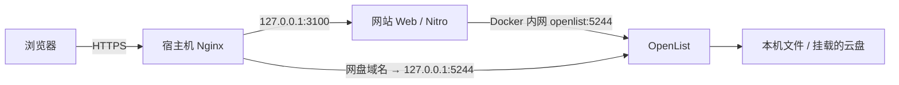

# Ubuntu 部署 OpenList 并连接社团网站

更新日期：2026-11-01  
适用环境：Ubuntu 22.04 / 24.04 / 26.04 LTS，Docker Engine + Compose 插件。  
对应功能：公开页 `/resources`、管理页 `/admin/resources`。  
本次核对的 OpenList 稳定版为 [v4.2.9](https://github.com/OpenListTeam/OpenList/releases/tag/v4.2.9)。部署时先核对官方发布记录，再锁定镜像摘要。

本手册以“社团网站已按仓库根目录 Compose 部署，Nginx 运行在 Ubuntu 宿主机”为主线。网站尚未部署时，先完成 [仓库 README 的 Docker 部署步骤](../README.md)，保留已有数据库、密钥和管理员账号。网站直接运行 Node 的情况见第 9 节。

## 目录

1. [部署结构与地址](#1-部署结构与地址)
2. [准备服务器和目录](#2-准备服务器和目录)
3. [启动 OpenList](#3-启动-openlist)
4. [配置域名与 HTTPS](#4-配置域名与-https)
5. [挂载社团资源目录](#5-挂载社团资源目录)
6. [获取网站使用的令牌](#6-获取网站使用的令牌)
7. [配置社团网站](#7-配置社团网站)
8. [连接检查和手动验收](#8-连接检查和手动验收)
9. [网站直接运行 Node 时的区别](#9-网站直接运行-node-时的区别)
10. [日常维护、备份和升级](#10-日常维护备份和升级)
11. [故障排查](#11-故障排查)
12. [配置速查与资料](#12-配置速查与资料)

## 1. 部署结构与地址

本文使用下列示例值，执行前替换成自己的域名和仓库目录。

| 项目 | 示例 |
| --- | --- |
| 网站域名 | `https://www.guatswr.top` |
| 网盘域名 | `https://pan.guatswr.top` |
| Ubuntu 上的网站仓库 | `/opt/GuatSWR_Website` |
| OpenList 配置和数据库 | `/srv/guatswr-openlist/data` |
| 实际资源文件 | `/srv/guatswr-openlist/files` |
| OpenList 本机存储回收站 | `/srv/guatswr-openlist/recycle` |
| OpenList 中的挂载路径 | `/社团资源` |
| 网站公开资源页 | `https://www.guatswr.top/resources` |
| 网站资源管理页 | `https://www.guatswr.top/admin/resources` |

请求路径如下：



网站负责页面、管理员登录和权限校验；OpenList 负责文件存储访问和文件操作。网站管理员账号与 OpenList 管理员账号是两套账号。

浏览器浏览列表时访问网站自己的 API；文件下载链接可能指向网盘域名或存储提供方。网站的 OpenList 令牌只保存在服务端。

**网站公开页会公开配置根目录下的文件。不要将网站数据库、密钥、备份、OpenList 的 `data` 目录或未公开资料放进资源目录。**

### 地址不能混用

| 谁访问 OpenList | 网站的 `NUXT_OPENLIST_BASE_URL` 应填什么 |
| --- | --- |
| 本文主线：Web 与 OpenList 在共享 Docker 网络 | `http://openlist:5244` |
| 网站直接运行在 Ubuntu 宿主机 | `http://127.0.0.1:5244` |
| 网站位于另一台机器，或没有共享容器网络 | 可访问的 `https://pan.guatswr.top` |

Web 容器内的 `127.0.0.1` 指向 Web 容器，不是 Ubuntu 宿主机，也不是 OpenList 容器。

## 2. 准备服务器和目录

### 2.1 检查 Docker 与现有网站

```bash
docker --version
sudo docker compose version
sudo systemctl is-active docker

cd /opt/GuatSWR_Website
sudo docker compose ps
```

Docker 未安装时，按 [Docker 官方 Ubuntu 安装文档](https://docs.docker.com/engine/install/ubuntu/)安装 Engine 和 Compose 插件。已有生产 Docker 环境不要为本手册重新卸载或替换 Docker。

以下扩展配置必须使用现有网站的同一个 Compose 项目名、插值文件和基础配置。若原部署使用了 `-p`、`--env-file` 或其他覆盖文件，应把它们一并保留在后面的 `dc` 函数中。

### 2.2 创建 OpenList 的独立目录

以下命令适用于**新目录**。如果目录内已有 OpenList 数据，应先备份，并保留原来的所有者和部署方式。

```bash
sudo install -d -m 0755 /srv/guatswr-openlist
sudo install -d -o 1001 -g 1001 -m 0750   /srv/guatswr-openlist/data   /srv/guatswr-openlist/files   /srv/guatswr-openlist/recycle
```

当前官方镜像默认使用 UID/GID `1001:1001`。`v4.1.0` 之后的镜像已移除旧的 `PUID` / `PGID` 设置方式，本文直接指定 `user`。[官方 Docker 说明](https://doc.oplist.org/guide/installation/docker)

### 2.3 准备 DNS 和入口

将 `pan.guatswr.top` 的 DNS 记录指向这台 Ubuntu 服务器；若设置 AAAA 记录，IPv6 也必须能到达同一服务。

公网入口使用 80、443。下面把 OpenList 的 5244 端口仅绑定到宿主机回环地址，不需要为它开放公网端口。

如果已有 Nginx/Caddy 或其他服务占用 80、443，复用现有反向代理，不要额外启动一套代理争用端口。

## 3. 启动 OpenList

### 3.1 拉取镜像并锁定摘要

先核对 [OpenList 官方发布记录](https://github.com/OpenListTeam/OpenList/releases)，然后拉取镜像。下面使用官方 `latest` 取得镜像，再记录不可变摘要；生产配置不长期依赖浮动标签。

```bash
sudo docker pull openlistteam/openlist:latest
sudo docker image inspect openlistteam/openlist:latest   --format '{{index .RepoDigests 0}}'
```

复制输出，例如 `openlistteam/openlist@sha256:…`。编辑仓库根目录的 Compose 插值文件 `.env`，增加：

```dotenv
OPENLIST_IMAGE=openlistteam/openlist@sha256:替换成刚才获得的完整摘要
```

保留文件内原有的 `WEB_ENV_FILE`、数据目录、镜像版本、网络等设置。若原部署使用其他插值文件，应修改那个文件，而不是另建一份互不生效的 `.env`。

### 3.2 增加 Compose 扩展文件

在网站仓库根目录新建 `compose.openlist.yml`：

```yaml
services:
  openlist:
    image: "${OPENLIST_IMAGE:?Set OPENLIST_IMAGE in the Compose env file}"
    user: "1001:1001"
    restart: unless-stopped
    init: true
    environment:
      TZ: Asia/Shanghai
      UMASK: "027"
    ports:
      - "127.0.0.1:5244:5244"
    volumes:
      - type: bind
        source: /srv/guatswr-openlist/data
        target: /opt/openlist/data
        bind:
          create_host_path: false
      - type: bind
        source: /srv/guatswr-openlist/files
        target: /srv/club-files
        bind:
          create_host_path: false
      - type: bind
        source: /srv/guatswr-openlist/recycle
        target: /srv/club-recycle
        bind:
          create_host_path: false
    networks:
      resources: {}

  web:
    networks:
      resources: {}

networks:
  resources:
    driver: bridge
```

这个文件在现有 `docker-compose.yml` 上增加 OpenList 服务和专用 `resources` 网络；Web 原有的 `app` 网络及固定地址继续保留，backend 不加入资源网络。[Compose 合并规则](https://docs.docker.com/compose/how-tos/multiple-compose-files/merge/)

### 3.3 使用固定的 Compose 命令

在仓库根目录的 Bash 中定义：

```bash
dc() {
  sudo docker compose     -f docker-compose.yml     -f compose.openlist.yml     "$@"
}
```

后续 `dc` 是这个 shell 函数，不是另外安装的命令。断开 SSH 后需要重新定义。若原来有自定义项目名、插值文件或覆盖文件，请在这里补齐，并始终复用同一套参数。

先检查配置，再仅启动新增的服务：

```bash
dc config --quiet
dc up -d openlist
dc ps openlist
dc exec -T openlist ./openlist version
curl -I http://127.0.0.1:5244/
```

看到网盘 HTTP 响应后继续。使用 `dc logs --tail=100 openlist` 排查启动失败，但初始日志可能包含管理员初始密码，不要原样公开。

此时还未重新创建 Web，Web 接入新网络的步骤放在第 7 节。

## 4. 配置域名与 HTTPS

以下示例适用于 **Nginx 运行在宿主机**。如果已有证书和代理配置，只补充网盘域名，不覆盖主站配置。

### 4.1 安装或确认 Nginx、Certbot

```bash
sudo apt update
sudo apt install nginx certbot python3-certbot-nginx
```

已有其他代理时，应使用对应代理的配置方式，不要直接执行这一节。

### 4.2 先建立网盘 HTTP 站点

创建 `/etc/nginx/sites-available/openlist`，写入：

```nginx
server {
    listen 80;
    server_name pan.guatswr.top;

    # 这是 OpenList 原生入口的代理上限，不是网站上传上限。
    client_max_body_size 2g;
    client_body_timeout 300s;

    location / {
        proxy_pass http://127.0.0.1:5244;
        proxy_http_version 1.1;

        proxy_set_header Host $http_host;
        proxy_set_header X-Real-IP $remote_addr;
        proxy_set_header X-Forwarded-For $proxy_add_x_forwarded_for;
        proxy_set_header X-Forwarded-Proto $scheme;
        proxy_set_header Range $http_range;
        proxy_set_header If-Range $http_if_range;

        proxy_request_buffering off;
        proxy_buffering off;
        proxy_read_timeout 600s;
        proxy_send_timeout 600s;
        proxy_redirect off;
    }
}
```

这里采用独立子域名，不把 OpenList 放到主站的 `/resources` 路径下；该路径由社团网站使用。代理指令可参考 [Nginx 官方说明](https://nginx.org/en/docs/http/ngx_http_proxy_module.html)。

首次启用这个新站点：

```bash
sudo ln -s /etc/nginx/sites-available/openlist   /etc/nginx/sites-enabled/openlist
sudo nginx -t
sudo systemctl reload nginx
```

软链接已存在时不要重复创建。若 `nginx -t` 不通过，先修正配置再重载。

### 4.3 申请证书

确认 DNS 和 80 端口可达，再执行：

```bash
sudo certbot --nginx -d pan.guatswr.top --redirect
sudo nginx -t
curl -I https://pan.guatswr.top/
sudo certbot renew --dry-run
```

按提示填写邮箱并完成证书申请。Certbot 会更新 HTTPS 配置；之后保留上面的上传、超时和 Range 相关指令。[Certbot Nginx 文档](https://eff-certbot.readthedocs.io/en/stable/using.html#nginx)

若网盘域名前还有 CDN/WAF，先确认它不会对 API、上传请求和带签名的下载链接返回验证页；排查时可先使用直达源站的 DNS 解析。

### 4.4 设置 OpenList 的外部地址

OpenList 的 `site_url` 应是浏览器能访问的 HTTPS 地址。它与网站的 `NUXT_OPENLIST_PUBLIC_URL` 都要设置正确。[官方配置说明](https://doc.oplist.org/configuration/configuration)

```bash
dc stop openlist
sudoedit /srv/guatswr-openlist/data/config.json
```

只把 `site_url` 字段改为下面的值，保留其他配置和已有随机密钥：

```json
{
  "site_url": "https://pan.guatswr.top"
}
```

**上面只是字段示例，不是完整的 config.json，不能用它覆盖整个配置文件。** 地址末尾不加 `/`。

```bash
dc up -d openlist
curl -I https://pan.guatswr.top/
```

## 5. 挂载社团资源目录

### 5.1 登录 OpenList

全新部署时，可以用下面的命令生成管理员随机密码：

```bash
dc exec -T openlist ./openlist admin random
```

该命令会重设 OpenList 管理员密码；已有实例不要为“查看密码”而重复执行。忘记密码时再使用。官方 CLI 支持 `admin random` / `admin set`。[手动安装与 CLI 说明](https://doc.oplist.org/guide/installation/manual)

访问 `https://pan.guatswr.top`，用 OpenList 管理员登录，进入它自己的“管理”界面。将密码保存到自己的密码管理器中，不写入仓库。

### 5.2 添加本机存储

在 OpenList 的“存储”页面新增“本机存储 / Local storage”，填写：

| 字段 | 值 |
| --- | --- |
| 驱动 | 本机存储 / Local storage |
| 挂载路径 | `/社团资源` |
| 根文件夹路径 | `/srv/club-files` |
| 回收站路径 | `/srv/club-recycle`，若该版本驱动提供此项 |
| 状态 | 保存后应正常启用 |

根文件夹填写 **容器内的路径** `/srv/club-files`，不是 Ubuntu 上的 `/srv/guatswr-openlist/files`。本机存储与回收站配置见 [官方驱动文档](https://doc.oplist.org/guide/drivers/local)。

在 OpenList 里打开 `/社团资源`，新建几个实际需要的目录，例如“联机工具”“STG 补丁”“同人音乐”“社团资料”。

网站原来的演示目录不会自动变成 OpenList 文件，也不会自动迁移。接入后展示的是这个真实挂载目录中的内容。

### 5.3 核对三层路径

| 层次 | 对应位置 |
| --- | --- |
| 网站看到的资源根目录 | `/` |
| OpenList 虚拟挂载路径 | `/社团资源` |
| OpenList 容器内实际目录 | `/srv/club-files` |
| Ubuntu 宿主机实际目录 | `/srv/guatswr-openlist/files` |

网站里的 `/联机工具` 对应 OpenList 的 `/社团资源/联机工具`。不要把“挂载路径”和“磁盘目录”填反。

### 5.4 开启全库搜索

在 OpenList 管理端打开“索引”，选择数据库索引，保存，再构建索引。小规模社团资源库可先用现有 SQLite 数据库完成索引，不必另外部署搜索服务。

构建完成后再验收网站的“全部资源”搜索；只配置存储但没构建索引，可能出现 `Search not available`。索引构建期间先避免并发改动文件。[官方搜索说明](https://doc.oplist.org/guide/advanced/search)

## 6. 获取网站使用的令牌

在 OpenList 管理端的“设置 → 其他 → 令牌 / Token”获取固定 API 令牌。不同版本菜单名称可能略有区别。[官方令牌说明](https://doc.oplist.org/configuration/other#token)

本项目的 `NUXT_OPENLIST_TOKEN` 直接作为 OpenList 的 `Authorization` 头发送，**填令牌原文，不添加 `Bearer ` 前缀**。

注意这不是以下任意一种值：

- 社团网站管理员的登录密码；
- 网站的 `JWT_SECRET` 或 `NUXT_SESSION_PASSWORD`；
- 浏览器 Cookie；
- 随手从登录响应里复制的、可能过期的短期登录 JWT。

固定令牌具有较高权限；当前 OpenList 实现将它对应到管理员。`NUXT_OPENLIST_ROOT_PATH` 是本站的目录边界，不会把 OpenList 的固定令牌本身变成受限令牌。[OpenList 认证实现](https://github.com/OpenListTeam/OpenList/blob/main/server/middlewares/auth.go)

因此，本手册建议该实例用于社团共享资源，令牌仅放在 Web 服务的私有环境变量中。不要添加 `NUXT_PUBLIC_` 前缀，也不要写入前端代码或公开配置。

在 OpenList 中核对相应用户/角色及存储驱动的上传、新建、重命名、移动、删除权限。网站管理端会结合服务端是否配置令牌以及目录接口的 `write` 值判断是否可写，实际操作仍由 OpenList 再次校验。

如果使用普通用户的短期登录令牌，需要自行管理失效和更新；本项目当前不会代为登录 OpenList、自动续期或处理它的二步验证。普通用户还可能存在“基本路径”映射，不能直接照抄本手册的全局挂载路径。[用户与权限说明](https://doc.oplist.org/guide/advanced/user)

## 7. 配置社团网站

### 7.1 修改 Web 的生产环境文件

仓库根目录 Compose 默认从 `web/.env.production` 注入 Web 环境变量；如果设置了 `WEB_ENV_FILE`，修改它指向的文件。

保留原有网站密钥及后端地址，补充：

```dotenv
NUXT_OPENLIST_BASE_URL=http://openlist:5244
NUXT_OPENLIST_PUBLIC_URL=https://pan.guatswr.top
NUXT_OPENLIST_TOKEN=替换为OpenList固定API令牌
NUXT_OPENLIST_ROOT_PATH=/社团资源
NUXT_OPENLIST_TIMEOUT_MS=8000
NUXT_OPENLIST_UPLOAD_TEMP_DIR=/tmp/guatswr-resource-upload

NUXT_BFF_AUTH_ALLOWED_ORIGINS=["https://www.guatswr.top"]
NUXT_BFF_AUTH_ALLOW_INSECURE_LOOPBACK_COOKIES=false
```

| 配置 | 用途 |
| --- | --- |
| `NUXT_OPENLIST_BASE_URL` | Nitro 服务端访问 OpenList API 的地址，不带 `/api` |
| `NUXT_OPENLIST_PUBLIC_URL` | 生成下载回退地址时使用的浏览器可达地址 |
| `NUXT_OPENLIST_TOKEN` | 服务端读写 OpenList 使用的凭据 |
| `NUXT_OPENLIST_ROOT_PATH` | OpenList 的虚拟挂载路径；不是磁盘路径 |
| `NUXT_OPENLIST_TIMEOUT_MS` | 常规 OpenList 请求的超时，默认 8000 毫秒 |
| `NUXT_OPENLIST_UPLOAD_TEMP_DIR` | Web 私有上传暂存目录；留空时使用系统临时目录 |
| `NUXT_BFF_AUTH_ALLOWED_ORIGINS` | 网站写请求允许的精确 Origin；填主站域名 |

若管理端实际通过 `https://www.guatswr.top` 或其他域名访问，把对应完整 Origin 一并写入 JSON 数组。不要把“网盘域名”误当作“网站管理端 Origin”。

上传暂存路径必须能被 Web 的运行用户写入，不能位于 `web/public` 或静态资源目录。仓库 Web 镜像使用 `node` 用户，示例的 `/tmp` 路径适用于普通可写容器；若另加只读根文件系统，需要提供可写的私有临时卷。

```bash
chmod 600 web/.env.production
```

使用自定义环境文件时，对实际文件设置权限。配置里不要留下示例令牌或 Windows 本地路径。

### 7.2 重建并重新创建 Web

如果服务器还没有包含资源管理页的最新网站镜像，先构建：

```bash
dc build web
```

然后重新创建 Web，让新环境变量和资源网络生效：

```bash
dc up -d --no-deps --force-recreate web
dc ps web openlist
```

这一步会短暂重建 Web 容器，应安排在可接受的维护时间。通常不需要重新初始化或重建 backend。

**只运行 `dc restart web` 不会把更新后的 `env_file` 重新注入已有容器。** 生产 Nuxt 产物也不会自动读取仓库里的 `web/.env`。环境变量必须传给实际运行的进程。

### 7.3 核对主站上传代理

仓库管理页单个文件上限为 **50 MiB**，每次最多选择 **20 个文件**，按队列依次上传，不自动覆盖同名文件。OpenList 原生入口的限制与此独立。

在主站 `www.guatswr.top` 的现有 HTTPS `server` 内，可为上传接口增加下面的精确匹配。不要另外创建一个同域名、重复监听的 `server`。

```nginx
location = /api/bff/admin/resources/upload {
    client_max_body_size 51m;
    client_body_timeout 90s;

    proxy_pass http://127.0.0.1:3100;
    proxy_http_version 1.1;
    proxy_set_header Host $http_host;
    proxy_set_header X-Forwarded-For $proxy_add_x_forwarded_for;
    proxy_set_header X-Forwarded-Proto $scheme;
    proxy_request_buffering off;
    proxy_read_timeout 240s;
    proxy_send_timeout 240s;
}
```

```bash
sudo nginx -t
sudo systemctl reload nginx
```

只提高 Nginx 限制不会提高网站代码里的 50 MiB 上限。游戏整合包等大文件可先通过 OpenList 原生页面上传，之后由网站浏览和下载。

## 8. 连接检查和手动验收

### 8.1 从 Web 容器检查连接

在网站仓库目录、定义好 `dc` 函数后执行：

```bash
dc exec -T web node --input-type=module - <<'JS'
const base = (process.env.NUXT_OPENLIST_BASE_URL || '').replace(//+$/, '');
const token = process.env.NUXT_OPENLIST_TOKEN || '';
const path = process.env.NUXT_OPENLIST_ROOT_PATH || '/';

if (!base || !token) {
  console.error('OpenList 地址或令牌未配置');
  process.exit(1);
}

const response = await fetch(base + '/api/fs/list', {
  method: 'POST',
  redirect: 'error',
  headers: {
    'Content-Type': 'application/json',
    Authorization: token,
  },
  body: JSON.stringify({
    path, password: '', page: 1, per_page: 10, refresh: false,
  }),
  signal: AbortSignal.timeout(8000),
});
const result = await response.json();
console.log(JSON.stringify({
  httpStatus: response.status,
  apiCode: result.code,
  write: result.data?.write,
  provider: result.data?.provider,
  total: result.data?.total,
}, null, 2));
if (!response.ok || result.code !== 200) process.exitCode = 1;
JS
```

预期 `httpStatus` 为 200、`apiCode` 为 200。还要结合 `write` 和下面的实际写入验收判断管理权限。

这段检查不会打印令牌，不要改成打印全部 `process.env`。注意 OpenList 某些业务错误仍返回 HTTP 200，所以只看 HTTP 状态不够。

### 8.2 验收公开资源页

```bash
curl -fsS 'https://www.guatswr.top/api/resources/list?path=%2F'   | python3 -c 'import json,sys; d=json.load(sys.stdin); print({"source": d.get("source"), "total": d.get("total"), "provider": d.get("provider")})'
```

预期 `source` 为 `openlist`。随后用浏览器逐项检查：

- [ ] `/resources` 不再显示演示模式，目录内容与 OpenList 的 `/社团资源` 一致。
- [ ] 展开目录树、进入子目录、返回上级正常。
- [ ] “当前目录”筛选可用。
- [ ] “全部资源”搜索能找到索引中的文件。
- [ ] 用浏览器无痕窗口下载一个小文件，确认不是登录页、HTML 错误页或演示说明。
- [ ] 下载链接中没有 `http://openlist:5244`、`127.0.0.1` 或其他浏览器不可达的地址。

`NUXT_OPENLIST_PUBLIC_URL` 只处理本站生成的回退下载地址；如果 OpenList 的 `raw_url` 已返回一个完整地址，本站会优先使用它。若该地址不可达，应修正 OpenList 的 `site_url`、存储驱动或代理设置，不能只改网站的 PUBLIC_URL。

### 8.3 验收资源管理页

用**服务器上的网站管理员账号**登录 `https://www.guatswr.top/admin/resources`。之前在开发电脑创建的临时管理员属于本地开发数据库，不会自动出现在 Ubuntu 生产数据库里。

以下只操作专门的验收目录和测试文件：

- [ ] 显示 OpenList，并显示“可管理”。
- [ ] 在资源根目录新建 `部署验收` 文件夹。
- [ ] 上传一个小的 TXT 或 ZIP 文件，上传队列显示完成。
- [ ] 打开公开资源页，确认能找到并下载刚上传的文件。
- [ ] 对这个测试文件重命名，刷新确认新名称。
- [ ] 创建另一个测试子目录，将文件移动过去；如返回任务已提交，等待后刷新确认。
- [ ] 再次上传同名文件，确认没有覆盖已有文件。
- [ ] 选择测试文件，删除确认框列出的名称正确，勾选确认后删除。
- [ ] 在 OpenList 原生页面确认操作结果；若配置了本机回收站，再核对回收站行为。
- [ ] 最后清理本次新建的空测试目录。

网站不提供文件恢复界面。回收站是否有效取决于 OpenList 驱动配置；不能把网站的删除确认当作恢复保障。

### 8.4 大文件与代理的边界

| 情况 | 处理方式 |
| --- | --- |
| 网站管理页上传超过 50 MiB | 使用 OpenList 原生管理页或存储提供方工具 |
| OpenList 原生页上传超过代理的 2 GiB | 根据需要调整网盘域名的 Nginx 限制，并核对驱动限制 |
| 客户端上传到网站超过 60 秒 | 网站当前接收文件有 60 秒时限；先用小文件和正常网络验收 |
| Web 转发到 OpenList 很慢 | 网站当前转发上传有 120 秒时限；不要把所有问题都归因于 Nginx |
| 移动后马上看不到目标文件 | OpenList 可能提交后台任务，等待并刷新确认 |
| 操作返回失败或超时 | 先查看目录实际结果，再决定是否重试，避免重复操作 |

这些网站限制来自当前实现，见 [资源管理契约](../packages/shared/src/resource-management.ts)、[上传接收](../web/server/utils/resource-upload.ts)和 [OpenList 写入适配](../web/server/utils/resource-management.ts)。

## 9. 网站直接运行 Node 时的区别

如果网站不是 Docker 部署，而是在宿主机由 systemd / PM2 运行：

1. 可在 `/opt/openlist` 单独创建 OpenList Compose 项目。
2. 使用第 3 节扩展文件中的 `openlist` 服务，删去 `web` 服务和 `resources` 网络相关部分，让 OpenList 使用普通默认网络。
3. 保留 `127.0.0.1:5244:5244` 端口映射、数据卷和 Nginx 配置。
4. 将 OpenList 所需的 `OPENLIST_IMAGE` 放进这个独立项目的插值文件。
5. 该项目命令改成 `sudo docker compose -f compose.yml …`，不要使用网站主线的 `dc` 函数。

网站实际运行进程应收到：

```dotenv
NUXT_OPENLIST_BASE_URL=http://127.0.0.1:5244
NUXT_OPENLIST_PUBLIC_URL=https://pan.guatswr.top
NUXT_OPENLIST_TOKEN=实际令牌
NUXT_OPENLIST_ROOT_PATH=/社团资源
NUXT_OPENLIST_TIMEOUT_MS=8000
NUXT_OPENLIST_UPLOAD_TEMP_DIR=/var/lib/guatswr/resource-upload
```

创建暂存目录时将所有者替换为**网站实际运行用户**，例如网站用户确实叫 `guatswr` 时：

```bash
sudo install -d -o guatswr -g guatswr -m 0700   /var/lib/guatswr/resource-upload
```

通过网站现有的 systemd `EnvironmentFile` 或 PM2 配置注入这些变量，再重启**实际的网站服务**。不要假设修改项目目录的 `.env` 就会改变已运行的生产进程。

本节与第 3 节主线是二选一。网站容器若仍在 Docker 里，就不能按本节使用宿主机回环地址作为 BASE_URL。

## 10. 日常维护、备份和升级

### 10.1 常用命令

以下主线命令都在网站仓库目录执行，SSH 新会话中先重新定义 `dc`。

```bash
dc ps web openlist
dc logs --tail=100 openlist
dc logs --tail=100 web
dc exec -T openlist ./openlist version
sudo du -sh /srv/guatswr-openlist/data   /srv/guatswr-openlist/files   /srv/guatswr-openlist/recycle
df -h /srv/guatswr-openlist
```

### 10.2 备份

至少分别保留：

- OpenList 的 `data`：数据库、设置、存储连接和账户状态；
- `files`：本机存储的真实文件；
- `recycle`：若需要保留已删除文件的恢复能力；
- 网站 Web 环境变量文件，以及 Compose 扩展文件和镜像摘要。

**网站原来的 backend 备份不会自动包含这些新增的 OpenList 数据目录。** 云盘挂载的数据也不等于已经备份在本地。

下面是停写后备份 OpenList 配置状态的示例，不包含所有实际资源文件：

```bash
backup_dir="/srv/guatswr-backups/openlist-$(date +%Y%m%d-%H%M%S)"
sudo install -d -m 0700 "$backup_dir"

dc stop openlist
sudo tar --numeric-owner -C /srv/guatswr-openlist   -czf "$backup_dir/openlist-data.tgz" data
dc up -d openlist
```

另外使用自己的备份工具对 `files` 和 `recycle` 做带版本的备份，放到独立磁盘或异机存储。数据库备份应在停止写入时完成，避免只复制一个正在变化的 SQLite 主文件而遗漏在途写入。

备份包含令牌和连接凭据，按私有数据保存。

### 10.3 升级

1. 记录现有 `OPENLIST_IMAGE` 摘要和 OpenList 版本。
2. 按上一节备份数据和实际文件。
3. 阅读目标版本的发布说明。
4. 拉取目标镜像，取得它的新摘要，更新 Compose 插值文件里的 `OPENLIST_IMAGE`。
5. 执行：

```bash
dc up -d --no-deps --force-recreate openlist
dc exec -T openlist ./openlist version
dc logs --tail=100 openlist
```

6. 重新做第 8 节的浏览、下载、上传和搜索验收。

不要因为“回滚镜像”就直接让旧程序打开已升级的生产数据库。数据库格式若有变化，需要使用相应版本的状态备份恢复。

### 10.4 恢复思路

恢复时先停 OpenList，将归档解压到**新的恢复目录**并核对内容；不要直接覆盖当前生产目录。确认数据所有者、版本和文件完整后，再把 Compose 的对应 bind mount 源路径改到恢复目录，检查配置并重建 OpenList。

恢复 `data` 只恢复设置和数据库；被删除或覆盖的资源需要从文件备份或已验证的回收站恢复。若恢复的 OpenList 状态使用旧令牌，还要同步更新 Web 环境变量并重新创建 Web。

## 11. 故障排查

| 现象 | 优先检查 |
| --- | --- |
| 网站仍显示演示模式 | 运行中的 Web 是否收到 `NUXT_OPENLIST_BASE_URL`；是否改错环境文件；修改后是否重新创建容器 |
| `ENOTFOUND openlist` | Web 与 OpenList 是否共享 `resources` 网络；重建 Web 时是否遗漏扩展文件 |
| `ECONNREFUSED 127.0.0.1:5244` | 网站是否在容器里；容器内应使用服务名 `openlist` |
| OpenList 无法启动、无法写配置库 | `data` 目录是否属于 UID/GID 1001；是否有足够磁盘空间 |
| 网盘目录为空 | 本机存储是否指向容器内 `/srv/club-files`；虚拟挂载路径是否为 `/社团资源` |
| `path not found` | `ROOT_PATH` 是否误填宿主机路径；OpenList 存储是否启用 |
| `Guest user is disabled` | 网站是否遗漏令牌；不要为了修复 BFF 认证而直接开放匿名写权限 |
| `token is expired` | 是否使用了短期登录 JWT；更新凭据，或按第 6 节使用固定 API 令牌 |
| 管理页只读或读取失败 | 令牌是否正确、目录是否可写；核对 OpenList 用户/角色、元信息、存储驱动和磁盘权限 |
| `Refresh without permission` | 管理端目录读取会请求刷新；OpenList 凭据还需要相应刷新/写入能力 |
| 能列目录但下载失败 | 先用无痕浏览器检查链接；查看 `site_url`、下载签名和驱动返回的 `raw_url` |
| 下载指向 `openlist:5244` | 内网地址进入了下载链接；检查第 4.4、7.1、8.2 节 |
| 上传返回 413 | 看文件是否超过网站 50 MiB、Nginx 限制或上游代理限制 |
| 上传失败且提示暂存目录不可用 | 检查 `NUXT_OPENLIST_UPLOAD_TEMP_DIR` 是否存在可写父目录、磁盘是否满、容器是否只读 |
| 搜索提示 `Search not available` | 在 OpenList 选择索引并完成构建 |
| 管理端写操作返回 `origin_rejected` | `NUXT_BFF_AUTH_ALLOWED_ORIGINS` 是否包含浏览器地址栏中的主站 Origin |
| 更新环境变量没有效果 | 使用 `up --force-recreate web`，而不是只 `restart web` |
| 上传、移动、删除报错后结果异常 | 先刷新网站和 OpenList，核对实际结果，再决定是否重试 |

检查 Web 环境变量是否存在时只打印布尔值，避免输出凭据：

```bash
dc exec -T web node -e 'console.log({baseConfigured:!!process.env.NUXT_OPENLIST_BASE_URL,tokenConfigured:!!process.env.NUXT_OPENLIST_TOKEN,root:process.env.NUXT_OPENLIST_ROOT_PATH,temp:process.env.NUXT_OPENLIST_UPLOAD_TEMP_DIR})'
```

OpenList 日志排查可参考 [官方错误码](https://doc.oplist.org/faq/error)。分享排查资料前，隐藏令牌、账户密码、云盘 Cookie 和带访问签名的私有链接。

## 12. 配置速查与资料

### 最终应达到的状态

- 网站正常访问，原有网站数据库和账号保留。
- OpenList 容器持续运行，真实文件与配置状态有独立持久化目录。
- 5244 只绑定宿主机回环地址；网盘通过独立 HTTPS 域名访问。
- 网站 Web 通过正确的网络地址访问 OpenList。
- 网站公开页只映射 `/社团资源`，不包含私有数据和备份。
- 网站管理页用网站账号登录；OpenList 令牌只在服务端保存。
- 公开下载、中文文件名、上传、重命名、移动、删除和索引搜索分别完成验收。

### 官方资料

- [Docker Engine：Ubuntu 安装](https://docs.docker.com/engine/install/ubuntu/)
- [Docker Compose：合并配置文件](https://docs.docker.com/compose/how-tos/multiple-compose-files/merge/)
- [OpenList：Docker 部署](https://doc.oplist.org/guide/installation/docker)
- [OpenList：配置文件](https://doc.oplist.org/configuration/configuration)
- [OpenList：本机存储](https://doc.oplist.org/guide/drivers/local)
- [OpenList：令牌](https://doc.oplist.org/configuration/other#token)
- [OpenList：用户与权限](https://doc.oplist.org/guide/advanced/user)
- [OpenList：搜索索引](https://doc.oplist.org/guide/advanced/search)
- [OpenList：文件系统 API](https://openlistteam.github.io/docs/guide/api/fs.html)
- [Nginx：反向代理指令](https://nginx.org/en/docs/http/ngx_http_proxy_module.html)
- [Certbot：Nginx 插件](https://eff-certbot.readthedocs.io/en/stable/using.html#nginx)

### 仓库内对应文件

- [网站部署总说明](../README.md)
- [根目录 Compose](../docker-compose.yml)
- [Web 环境变量模板](../web/.env.example)
- [公开资源适配](../web/server/utils/openlist.ts)
- [管理端文件操作](../web/server/utils/resource-management.ts)
- [上传暂存处理](../web/server/utils/resource-upload.ts)
- [上传限制与输入契约](../packages/shared/src/resource-management.ts)
