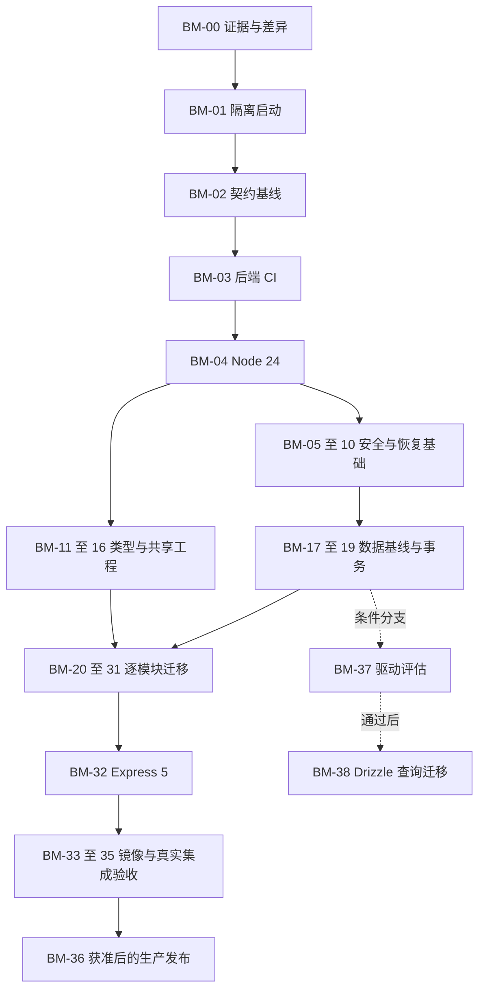

# 后端现代化迭代方案与执行入口

实施已于 2026-10-23 按用户指令启动，进度见 [STATUS.md](STATUS.md)。下文“本轮仅规划”“不提交推送”等描述保留规划时的历史边界；实施以最新用户授权及 STATUS 为准。

版本：2.0（源码核对版）｜日期：2026-10-23（Asia/Shanghai；初步核对始于 2026-10-22）

本方案把用户提供的 1.0 初稿转化为可分批执行、审查和交接的任务。**本轮仅新增规划文档；没有改动业务代码、依赖、数据库、部署或运行服务。**

| 阅读入口 | 用途 |
| --- | --- |
| [执行表](EXECUTION.md) | BM-00～BM-39 的依赖、实施步骤、产物、验收和回退；后续 agent 的主工作台 |
| [接口台账](API-INVENTORY.md) | 71 个显式 API 操作、源码位置、现有鉴权、OpenAPI 缺口与 BFF 映射 |
| [验收矩阵](ACCEPTANCE.md) | 契约、状态、权限、并发、迁移、恢复、发布测试要求与证据格式 |
| 本文 | 范围、源码结论、技术决策、风险与推进原则 |

## 1. 基线、证据边界与授权范围

| 项目 | 本次核对结果 |
| --- | --- |
| 仓库位置 | `E:\Taropoi\workspace\GuatSWR_Website` |
| 当前分支 | `revamp/nuxt-foundation` |
| 当前提交 | `1f057a9a4792ee4f79cedec9d28ebd1c8521f417` |
| 初稿基线 | `0ddea0fd`；后续实施不能直接当作当前代码 |
| 开始规划时的工作区 | `git status --short` 为空 |
| 后端 | `guiair-backend`，独立 npm；CommonJS；`server.js` 启动 |
| 锁定依赖 | Express 4.22.1、sqlite3 5.1.7、sharp 0.33.5、Multer 1.4.5-lts.2、Zod 3.25.76；以 `backend/package-lock.json` 为证据 |
| 工作区 | pnpm 11.25.0；`.node-version` 为 24.16.0；shared 为 ESM，Zod 4.6.7；backend 不在 workspace |
| 环境差异 | 本次终端 `node --version` 返回 v22.23.2，不能据此宣称 Node 24 验收；本轮仅用其做静态文本统计 |
| API 规模 | 路由文件中 70 个操作，加 `/api/version` 共 71 个；OpenAPI 记载 56 个，遗漏 15 个 |
| 数据文件 | 本地存在两个 `.db` 及对应 WAL/SHM；本轮只查看文件名/大小，没有连接、复制、迁移或读取业务记录 |
| 测试证据 | 本轮未启动后端、未安装依赖、未跑应用测试；文档中的测试均为未来验收要求 |
| 环境事实待核验 | 实际线上镜像、代理拓扑、SQLite 引擎版本、数据库真实结构/脏数据、磁盘容量、备份可恢复性、AstrBot 接收端配置 |

通读范围包括全部 `backend/src` 实现及现有测试、启动文件、Docker/Compose、OpenAPI 的接口登记、两套数据库备份入口和恢复脚本；交叉核对了 Nuxt 固定上游路由、会话/IP 处理、公开投影、游客边界、管理工作流、共享契约、现有 CI 和迁移状态文档。源码推断不等于漏洞复现，也不等于生产状态确认。

当前用户只授权规划。后续 agent 接到实施指令后，按执行表启动相应任务。建议独立实现分支 `codex/backend-modernization`；如维护者沿用初稿命名，则使用其指定的 `revamp/backend-modernization`。本轮不建分支、不提交、不推送。既有 `docs/revamp/COORDINATION.md` 描述历史前端协作，不构成本次部署、发消息或启动其他 agent 的授权。

保留现有 3100 开发服务；测试使用独立端口、独立数据目录和测试密钥。服务器、DNS、Cloudflare、正式数据库及主站流量变更只在 BM-36 的发布授权范围内执行。

## 2. 目标与完成层次

保持模块化单体、SQLite WAL 和 Nuxt BFF，完成 Node 24、可测试启动、TypeScript、Zod 4 契约、版本化迁移、必要安全修复、Express 5、可恢复部署。

不引入 NestJS、微服务、Redis、Kubernetes 或 PostgreSQL；不重做页面，不批量重置密码，不默认增加标准 TOTP。驱动替换、Drizzle 查询迁移、二步密码新加密格式分别作为条件分支，不能阻断基础现代化。

交付分三级，不能混用“完成”：

1. **工程完成**：BM-00～BM-35 中所有必需任务通过，含真实 SQLite、真实后端+BFF 和隔离恢复演练。
2. **候选版本可发布**：精确镜像/提交、迁移、环境差异、恢复和性能证据齐全；前端独立发布门禁也通过。
3. **生产验收完成**：BM-36 获准并执行，观察窗口和恢复判据满足。前两级不能写成“已上线”。

`docs/revamp/STATUS.md` 的 798 单元测试及现有 E2E 是特定前端版本的历史证据，不能替代本次后端验证。其无障碍、性能、生产配置和远程 CI 等未关闭事项继续独立跟踪。

## 3. 对初稿的关键修订

| 编号 | 源码事实与影响 | 本方案处理 |
| --- | --- | --- |
| F01 | `models/db.js` import 即建目录、开双库、设 PRAGMA；`event.js` import 建表；`auth.js` import 启动定时器；`app.js` 调初始化和调度且不等待完成 | 先解决测试隔离与启动可等待性；禁止测试直接 import 生产默认实例 |
| F02 | `event_participants` 已有两个 UNIQUE；报名已用 UPSERT | 不再计划“补唯一约束”；先验证同 IP 多账号、NULL、冲突目标不同、并发取消等真实语义 |
| F03 | `event PUT /:id` 仅限制匿名修改 `published`，未核对草稿 owner；游客内容上传只核对 EID 状态 | BFF 归属校验不能替代后端边界；先封闭直连，再设计可信草稿证明；必须有兼容性例外 |
| F04 | 后端报名只查 type/status，没有读取 `content.deadline`；BFF 才校验明确 deadline，`time` 是活动时间 | 不把 BFF 行为误记为后端现状；后端补 deadline 是独立业务修复 |
| F05 | `bot.js` 真实发三个通知；`botHooks.js` 的 `callBotHook` 直接返回 null | 保留三个真实通知；Event 自动通知是新增功能，默认仍关闭，不能声称原有 Event 通知可靠投递 |
| F06 | `admin.js` 只阻止删自己；BFF 最后超级管理员保护是单进程锁；JWT 权限中间件主要信任签名声明 | 身份现查、管理员删除并发保护列为早期安全修复；高风险认证结构重构仍在后期 |
| F07 | `getTokenVersion` 查询错误回退到 0；改密码/二步密码未撤销后端旧 JWT；BFF 只撤销本地记录 | 区分全局版本、后端用户级失效与 BFF 会话；不声称现有系统具备全链路密码修改撤销 |
| F08 | `/api/config` 写接口允许任意 key，普通 admin 可写内部键；公开 `/api/logs` 返回原始 details；Event 列表 `e.*` 带 visitor_ip | 安全隔离与公开投影独立修复，不能把泄露行为作为永久兼容契约 |
| F09 | `history POST` 的 sqlite 回调用箭头函数读取 `this.lastID`；读取群史 SQL 失败仍返回 `[]` | 分别建立回归；ID 缺失和错误伪成功按缺陷例外修复，不能由 ORM 重构顺手更改 |
| F10 | storage 用字符串 startsWith 检查目录；管理员 activityId 未严格限制；文件搬移/删除与 DB 不原子 | 先堵目录边界，再改文件提交/清理流程；覆盖同前缀兄弟目录、`..`、symlink、EXDEV |
| F11 | `/uploads`、Swagger 在 Helmet 前；SVG 只查前 256 字节是否含 `<svg`；暂存目录也在公开树 | 保留 SVG 兼容需逐入口隔离；禁止直接取消 SVG 而不核对用户资源；未验证文件不能先公开 |
| F12 | 两套 db_backup 脚本在缺 sqlite3 时直接 cp；仅成功备份一个库仍可能整体成功 | 备份基础修复提前；两个库必须同时纳入且校验通过，缺工具/库须失败 |
| F13 | restore 固定默认数据库路径、覆盖数据、删除 WAL/SHM；未强制停写、未先完整验证归档 | 新恢复流程先验包/验路径/验双库，再写新目标；旧脚本不能直接用于演练原数据 |
| F14 | 调度器 30 秒轮询，没有运行互斥、子进程期限；用宿主本地时间；备份发现路径依赖目录向上扫描 | 明确 Asia/Shanghai、绝对路径、互斥和完成状态；手动/调度/cron 不重复执行 |
| F15 | Umami 位于 logs 模块；缓存 key 没有 envType；HTTP body/缓存容量没有显式上限 | 作为独立集成维护，保留响应形状，补键和资源边界；不能遗漏 Umami |
| F16 | shared 只有 import 导出；旧后端是 CommonJS；根 `.dockerignore` 排除了大部分 backend | 在共享契约接入前解决双格式消费；最终根上下文 Docker 打包必须修正忽略规则 |
| F17 | backend 没有 test/typecheck/lint script，只有一个 node:test 文件；现有 PR path filter 不包含 backend | 先增加独立后端 CI，不能把根 `pnpm test` 通过视为后端覆盖 |

## 4. 技术决策与决策记录

### 4.1 已确定的实施方向

| ADR | 决策 | 约束与验收 |
| --- | --- | --- |
| ADR-01 | Node 24，具体补丁版本实施时核验并与根工作区一致 | Node 官方发布表标记 v24 为 LTS；镜像用已验证版本/digest。Native 模块从干净 Linux 环境安装；不得把终端 Node 22 当目标环境。[官方版本表](https://nodejs.org/en/about/previous-releases) |
| ADR-02 | TypeScript 渐进编译，先保留后端 CommonJS | 新 TS 文件严格检查；遗留 JS 允许过渡，但范围只减不增。`__dirname` 在 dist 后仍指向正确 data/docs/scripts；不要把数据写进 dist |
| ADR-03 | Zod 4 用于 wire 契约，DTO 与数据库记录、页面状态分离 | 先对照 Zod 3 的 coercion/default/nullable/unknown stripping/首条错误文本；响应测试不能通过删除旧字段掩盖差异 |
| ADR-04 | shared 增加经过验证的 ESM/CJS 条件导出，独立提交 | Nuxt 继续用 ESM；后端 CJS 用独立构建目录及正确 module/type 声明；不直接 require TS，不依赖 root node_modules 偶然解析 |
| ADR-05 | 第一轮继续 sqlite3 + 参数化 SQL Repository | Drizzle 先做 schema 建模/差异审阅，不宣称已使用 ORM 查询。官方列出的 SQLite 驱动为 libsql、node:sqlite、better-sqlite3，不能假设现有 sqlite3 可直接接入。[官方驱动说明](https://orm.drizzle.team/docs/sqlite/get-started-sqlite) |
| ADR-06 | 主库、日志库分别建立 SQL 迁移账本；应用仅校验版本 | 迁移 SQL 与 checksum 是执行真相；Drizzle 生成物需审查。禁止同时维护两套会执行的独立迁移账本 |
| ADR-07 | 显式资源生命周期；单实例部署 | 创建 app 无监听/计时器/默认业务库副作用；server 负责启动和释放；不扩副本数来解决性能问题 |
| ADR-08 | Pino 诊断日志与 audit_logs 业务审计分工 | 请求 ID 不可无限信任外部字符串；红线字段过滤；审计失败不能变成未捕获异常 |
| ADR-09 | Express 5 单独升级 | query parser 默认改变、body 缺省、异步异常、static MIME/dotfiles、监听错误逐项验证；不同时换 ESM/驱动。[官方迁移指南](https://expressjs.com/en/guide/migrating-5/) |

Drizzle 当前在线文档部分示例使用 `@rc`。实施时必须核对锁定稳定版本，不能复制该安装命令。官方说明 `pull --init` 会把基线记为已应用迁移，因此它不是纯只读内省；仅允许在一次性副本验证，不对原库执行。[pull 文档](https://orm.drizzle.team/docs/drizzle-kit-pull)

### 4.2 必须形成结论的决策点

“待决策”不是要求现在打断用户，也不是授权 agent 擅自切换协议；先产出可比较的方案、测试影响和建议，再由相应任务收口。

| ADR | 默认建议 | 决策时机/阻断范围 |
| --- | --- | --- |
| ADR-10 真实代理链 | 只信任 Nuxt/实际反代 CIDR；公网不可直达 Express；BFF 重建单值 XFF | BM-05 收集部署方事实；无事实可完成本地验证，不能完成生产网络验收 |
| ADR-11 游客身份 | 兼容现有 IP 报名身份；草稿写入使用受信入口与绑定 EID 的不可伪造证明 | BM-08 先界定旧直连客户端；BM-24 才落实证明。不能以 IP 相等宣称两位 NAT 后游客隔离 |
| ADR-12 报名同 IP 规则 | 基础迁移保留两个 UNIQUE 和原身份选择 | BM-25 测试登录/匿名切换及同 NAT 多账号；若要改善，单独协议/数据迁移，禁止顺手删索引 |
| ADR-13 公开个人信息 | 原 IP/凭据/内部配置一律不公开；QQ 等联系字段按现有前端投影核对用途 | BM-09 形成字段清单及安全例外；不要全量删字段造成前端静默降级 |
| ADR-14 审计一致性 | 常规内容写成功但审计故障不改成可重试的业务失败；可靠追踪用主库 outbox | BM-19决定：安全操作在BM-31事务改造时须同库持久化审计意图，Expand引入outbox并独立投递/去重；当前未实现。两个独立库不能伪装成一个事务 |
| ADR-15 备份一致点 | 恢复点包含双库+public+manifest，发布演练采用受控停写窗口 | BM-10 定方案；在线单库快照不能证明三者在同一业务时点 |
| ADR-16 性能/RPO/RTO | 性能候选门槛见验收矩阵；RPO/RTO 根据数据量、停写窗口实测定值 | BM-35 前必须填入数值、负责人和证据，不能留“可接受”后放行 |
| ADR-17 Drizzle 查询/驱动 | 默认延期，不构建自定义 sqlite3 ORM 适配器 | BM-37、38 条件分支；必须先 POC，后驱动，后查询迁移 |
| ADR-18 二步密码格式 | 基础阶段兼容 CBC；不换 TWOFA_SECRET/JWT_SECRET；标准 TOTP 不在本计划 | BM-39 如启用 GCM，先验证双读、新写及旧应用回退；不能因旧应用不认识新密文而破坏回滚 |

代理设置要与实际每条请求路径一致；全量信任与固定跳数都不能脱离拓扑套用。[Express 代理说明](https://expressjs.com/en/guide/behind-proxies/)

## 5. 数据与存储边界

### 5.1 按源码推导的 schema（不是生产库实测）

| 数据库/表 | 关键结构与约束 | 必须保留/核验 |
| --- | --- | --- |
| 主库 users | 自增 id、username UNIQUE、password、role、avatar、twofa_secret、twofa_enabled | bcrypt 原哈希；CBC 原密文；0/1 标记；历史空值；没有用户级 token_version 列 |
| 主库 activities | 内容、images JSON 文本、作者/更新者、status、deleted_at/by | 历史 status NULL 作为公开；详情 created_by/updated_by 被映射为用户名，与列表不同 |
| 主库 members | school、tags JSON 文本、sort_order、软删除 | 历史额外 bio 可能存在，API 已排除；avatar/thumb 真实文件与原图模式 |
| 主库 history | date、sort_order、image、软删除 | 日期为文本；ASC 排序；History 目录大小写必须保留 |
| 主库 site_config | key 主键、value 文本 | 同时承载公开配置、token_version、backup_*；不要无差别作为公开 DTO |
| 主库 login_attempts | IP 主键、计数、lock_until/updated_at 整数 | 毫秒时间；并发失败次数；过期重置语义 |
| 主库 banned_ips | IP 主键、reason、created_at/expires_at、created_by | IPv4/IPv6 标准化；expires_at NULL 与 0；查询失败策略 |
| 主库 events | type、content JSON 文本、status、created_by、visitor_ip、created_at/updated_at | 删除为 status='deleted'；没有 deleted_at；历史 type='general' 不能被 shared 五类型 schema 拒绝读取 |
| 主库 event_participants | event_id 外键级联；UNIQUE(event_id,user_id)；UNIQUE(event_id,visitor_ip) | NULL 唯一性、同 IP 冲突、身份切换；禁止新增“常用ID唯一”假设 |
| 日志库 audit_logs | id、username、action、details、created_at；用户名/时间索引 | 单独文件；公开/后台投影不同；输出时间转换 +08:00，不把存储值整体再加 8 小时 |

源码预计主库 9 张业务表、日志库 1 张；`sqlite_sequence`、自动索引、历史扩展表由 BM-17 实测。现有 PRAGMA 为 WAL、synchronous=NORMAL、foreign_keys=ON、busy_timeout=5000，需验证每个实际连接均生效。

sqlite3 npm 包版本、其嵌入的 SQLite 引擎版本、镜像 sqlite3 CLI 版本是三件事。BM-04/BM-17 必须记录 `sqlite_version()` 与 CLI 版本并核对维护公告；不能仅升级 Node 后宣称数据库引擎安全。

### 5.2 路径契约

| 当前路径 | 使用方 | 迁移要求 |
| --- | --- | --- |
| backend/data/*.db | db.js；DB_PATH/LOG_DB_PATH 相对 data 解析 | 可注入绝对测试路径；相对生产值兼容；日志库不能漏掉 |
| backend/data/public/upload | Multer 暂存、cleanupStaging | 规划改为私有验证区后再发布；已有 URL 的过渡单独处理 |
| public/img/activity/{id} | 文章封面/内容图 | activity 单数，不改成 events |
| public/img/events/{eid}、avatars | Event 内容/报名头像 | 永久删除/取消报名/复用引用的清理规则分别处理 |
| public/img/History/YYYY/MM/DD | 群史 | Linux 大小写与历史非标准日期保留 |
| public/img/user、bg、assets、Join_QR；public/icon_svg | 用户/成员/配置/图标 | 共用文件不可由一个资源删除而误删别处引用 |
| backend/backups 与根 backups | 自动发现脚本 vs 根 cron | 实测路径后统一配置，不猜 `./uploads` 是实际资源目录 |
| /uploads/** | Express static，Nuxt 资源代理 | 对外 URL 保持；真实文件访问、Content-Type、SVG sandbox、缓存均验证 |

SQLite 在线备份是获取单库一致副本的基础；WAL 相关文件不能在活跃写入时随意忽略。两个 WAL 数据库和文件系统没有自动跨资源原子性，完整恢复点还需停写/快照协议。[SQLite Backup API](https://www.sqlite.org/backup.html)、[SQLite WAL](https://sqlite.org/wal.html)

## 6. 迭代路线与门禁

图示为阶段概览；精确依赖以执行表为准。任务号表示推荐审查顺序，不表示所有工作必须串行。BM-34 的真实后端集成脚手架要在 BM-02/03 提前建立，最终验收才在后期闭环。

| 里程碑 | 退出条件 | 允许进入下一阶段 |
| --- | --- | --- |
| M0 可测 | BM-00～03；全部操作登记；高风险成功/失败基线；旧行为缺陷有编号 | 可以小批改变实现 |
| M1 可保护/可恢复 | BM-04～10；可信代理；关键越权/路径边界；隔离双库恢复成功 | 可以在独立分支做结构迁移 |
| M2 可构建/可迁移 | BM-11～19；shared 消费与双库版本账本通过；无 import 副作用 | 可以逐模块替换 Repository |
| M3 模块完成 | BM-20～31；逐模块原 API/BFF/DB 效果回归 | 可以单独升级 HTTP 框架 |
| M4 候选版本 | BM-32～35；Linux 镜像、真实集成、恢复/性能证据；安全例外关闭 | 可以申请精确版本发布 |
| M5 生产完成 | BM-36 授权、发布、观察和恢复判据通过 | 可以宣称上线；Contract 删除旧字段另开任务 |

每任务默认一个可独立回退的 PR。BM-06、BM-07、BM-10 等安全任务可拆为 a/b 子 PR；一个子 PR 只动一个主要风险面。需要协议和 schema 的任务必须先做兼容 Expand，再改使用方，不能把它们包装成“无行为变化重构”。

工作量用于排程，不是完成承诺：M0 约 4～7 人日，M1 约 7～12 人日，M2 约 7～12 人日，M3 约 12～20 人日，M4 约 5～8 人日；总计约 35～59 人日，不含生产审批等待和条件分支。BM-02 后按真实失败数量重估。不能为了历史文档的 2026-11-11 预估上线日期省略安全/恢复门禁。

## 7. 后续 agent 的执行规则

1. 阅读本文、所接任务、接口台账和对应验收组；用 `git status`、HEAD、相关源码确认计划没有过期。前置任务尚未验收时，先完成前置或记录明确阻塞。
2. 只实施选定任务的文件范围；需要动 shared/锁文件/CI/数据库启动入口时在任务记录中扩展范围。不要复用历史前端协作中的推送或消息授权。
3. 先写失败可复现用例。现状缺陷另列 EX 编号，写出旧行为、目标行为和消费者影响；不能简单更新全部快照。
4. 所有运行都显式指定临时主库、日志库、public、backup、端口、测试密钥和关闭真实 Webhook。当前默认后端不能安全地靠 NODE_ENV=test 隔离。
5. 验证完成后提交任务报告，记录完整命令、退出码、Node/OS、提交、fixture 来源、正反例、未完成项。运行失败和未运行不得写“通过”。
6. 数据/文件修改必须给出失败中断和恢复测试；应用回滚兼容矩阵必须覆盖旧镜像读新数据，不只是能起进程。
7. 更新执行表状态和证据链接。文档规划完成不等于 BM-00 已验收；BM-00 还要建立可运行基线、精确消费者矩阵和决策台账。

## 8. 完成定义与停止条件

工程完成必须同时满足：Node 24 精确版本与双平台/容器验证；核心 TS 严格检查；71 个旧 API 操作均有兼容结果或批准例外；新增健康接口另登记；主库/日志库可从空库和历史副本迁移；真实 Nuxt+BFF+Express 回归；备份恢复演练；Express 5 独立验证；可观测故障；可复现镜像及版本化发布资料。

任一越权、敏感字段外泄、草稿跨访客访问、不可解释数据差异、文件丢失、备份不能恢复、未知迁移漂移、启动仍自动改结构、重复自动通知、未批准契约变化，都阻止该阶段验收。可继续处理其他不依赖项；不能用跳过失败测试、修改历史证据、降低预算或重试直到偶然通过放行。

生产恢复不能盲目覆盖快照：新版本已有写入时，先停写和保全当前状态，再按兼容旧应用或数据协调方案恢复。不可逆变更留在独立 Contract 阶段。生产验收与前端尚未关闭的发布条件共同决定，不由本计划单方面宣布完成。
